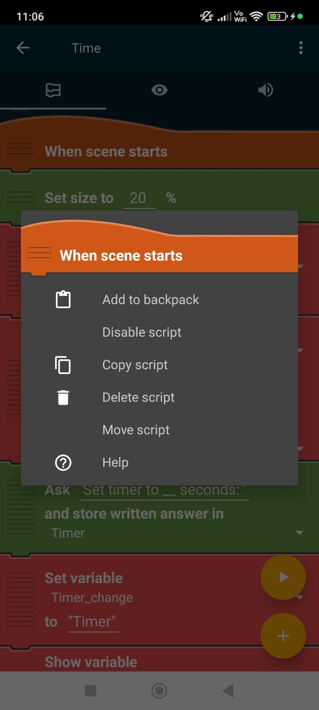

Die **Rugsak** funksie in Pocket Code is 'n praktiese funksie wat jou toelaat om **stoor en hergebruik** elemente soos akteurs (voorwerpe), skrifte, voorkoms of klanke **oor projekte** te maak. Dit help jou om tyd te bespaar en jou projekte doeltreffender te maak.

Die rugsak is soos 'n digitale bergingsplek waar jy verskeie elemente van jou huidige projek kan stoor. Sodra jy dit in die rugsak gestoor het, kan jy hierdie elemente na ander projekte haal en insit.

### Hoe gebruik ek die rugsak vir akteurs (voorwerpe)?

**Pak die figure in die rugsak**

Gaan na die projekskerm van die projek waaruit jy 'n figuur in die rugsak wil pak.

Die figuur (insluitend sy voorkoms, klank en skrifte) sal in die rugsak verpak word.

\
Klik op die drie punte langs die figuur om die konteksmenu oop te maak en kies “Pak in”.\
[Maak prent oop](../../../media/getting-started/grafik-7.png)

**Voeg syfers uit die rugsak by**

Maak die projek oop waar jy die figuur wil inset.

In die projekskerm tik op die plus-symbool en kies “Rugsak”.

Jy sal nou al die figure en voorwerpe sien wat jy in jou rugsak gestoor het.

\
Tik op die drie punte en kies “Pak uit”.\
[Maak prent oop](../../../media/getting-started/grafik-8-e1732702791199.png)

***

### Hoe gebruik ek die rugsak vir skrifte?

**Sit skrifte in die rugsak:**

Gaan na die figuur wat die skrif bevat. Hou die gewenste skrif in die skrifredigeerder.

\
Kies “Voeg by rugsak” uit die kontekskieslys.\
[Maak prent oop](../../../media/getting-started/WhatsApp-Bild-2024-11-27-um-11.09.00_bec028aa.jpg)

\
Gee die skrif 'n naam en bevestig met OK.\
[Maak prent oop](../../../media/getting-started/grafik-9.png)

\
Die skrif word gestoor en kan in ander projekte gebruik word.\
[Maak prent oop](../../../media/getting-started/grafik-10.png)

**Voeg skrifte uit die rugsak:**

Tik op die akteur waar jy die skrif wil insit. Jy sal die scenario area sien.

\
Tik op die drie punte om die kontekskieslys oop te maak en tik op “Rugsak”.\
[Maak prent oop](../../../media/getting-started/grafik-11.png)

Jy kan nou al die skrifte sien wat reeds in jou rugsak is.

Deur die kontekskieslys, kan jy skrifte wat jy nie meer nodig het in jou rugsak te verwyder.

\
Tik op die drie punte langs die gewenste skrif en kies “Pak uit” uit die kontekskieslys.\
[Maak prent oop](../../../media/getting-started/grafik-12.png)

***

### Voordele van die rugsak

- **Kruisprojek hergebruikbaarheid:** Figuur, skrifte, klanke en voorkoms kan een keer geskep word en so dikwels as wat nodig is hergebruik word.
- **Tydbesparing:** Jy hoef nie elke keer figure of skrifte weer te skep nie.
- **Konsekwentheid:** Elemente bly konsekwent wanneer jy dit oor verskeie projekte nodig het.
