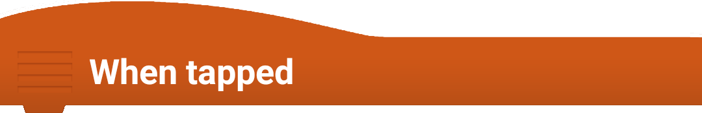

Loop die skrif wanneer die voorwerp aangetap word.

Die verskil met die blok *“Wanneer verhoog getik word”* is dat *“Wanneer getik”* spesifiek vir individuele sprites of voorwerpe is, terwyl *“Wanneer verhoog getik word”* op die hele skerm van toepassing is.
