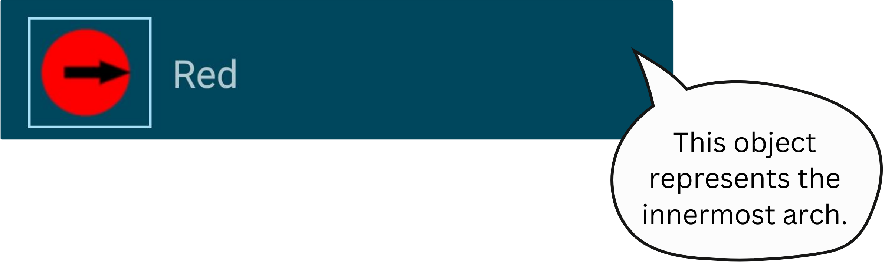

في هذا الدرس ستتعلم كيف تطرّز قوس قزح (112 × 57.2 ملم).

يجب أن تكون تعرف بالفعل ما هي الحلقة وكيف تعمل.

قد يفيدك درس **[نصف الدائرة](../embroidery-tutorials-beginner/semicircle.md)** في هذا الدرس.

اطلع على دروس التطريز في سلسلة [المبتدئين](../embroidery-tutorials-beginner/index.md) إذا لم تطرّز أي شيء بعد.

لمزيد من المعلومات أو اقتراحات التصميم، اطلع على الدروس الأخرى.

*يمكنك تنزيل الدرس بصيغة PDF هنا*:

[قوس قزح](../../../media/embroidery-tutorials/Rainbow.pdf)

### 1. أنشئ كائن تطريز جديدًا (انظر [إنشاء كائنات التطريز](../embroidery-tutorials-beginner/create-embroidery-objects.md)):

### 2. أضف البرنامج النصي التالي:

### 3. انسخ الكائن

للقوس الأكبر التالي، يمكنك ببساطة نسخ الكائن الذي أنشأته للتو.

انقر على النقاط الثلاث في الزاوية اليمنى العليا من نظرة عامة الكائنات.

ثم اذهب إلى "نسخ" واختر الكائن.

إذا استخدمت كائنًا منفصلًا لكل قوس، يمكنك لاحقًا تطريزها بألوان مختلفة.

### 4. عدّل الكائن

لكي تصبح الأقواس بأحجام مختلفة، علينا تغيير بعض القيم.

لفعل ذلك، اذهب إلى برنامج الكائن المنسوخ، وعدّل القيم التالية:

### 5. كرّر الخطوتين 3 و4 لمزيد من الأقواس!

### 6. اضغط على تشغيل لبدء تصميمك!
