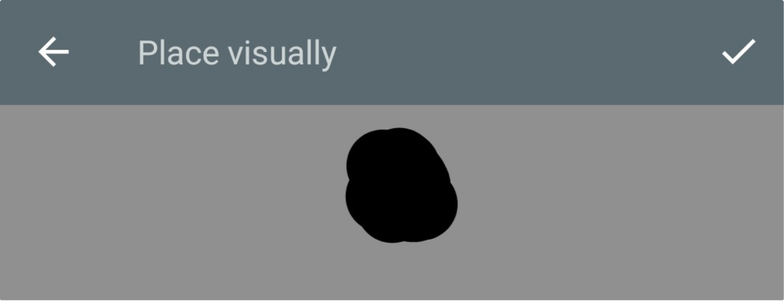

في هذا الدرس ستتعلم كيف تنشئ كائنًا جديدًا في مشروعك، وما الطرق المختلفة لذلك.

لتنفيذ ذلك، يجب أن تكون قد نزّلت تطبيق Pocket Code وعرفت كيف تنشئ مشروعًا جديدًا. إذا احتجت إلى مساعدة في ذلك، فاطلع على درس **[مشروع جديد](new-project.md)**.

*يمكنك تنزيل الدرس بصيغة PDF هنا:*

[كائن جديد](../../../media/game-tutorials/New-Object.pdf)

### 1. أنشئ كائنًا جديدًا

أولًا، تحتاج إلى فتح مشروعك الجديد.

ستجده في الشاشة الرئيسية لتطبيق Pocket Code. إذا كان لديك أكثر من مشروع، يمكنك النقر على "Projects on device". ثم اختر مشروعك الجديد. إذا لم تنشئ مشروعًا جديدًا، أو تحتاج إلى معلومات أكثر عن ذلك، فاطلع على درس **[مشروع جديد](new-project.md)**.

### 2. أنشئ كائنًا جديدًا

الآن أنت جاهز لإنشاء كائن جديد. لفعل ذلك، انقر على زر الزائد الأصفر في الزاوية اليمنى السفلى. سترى نافذة جديدة تعرض لك سبعة خيارات تختار منها.

### 3. طرق الإنشاء

هذه هي الخيارات التي يمكنك الاختيار منها:

### 4. ارسم صورة

لتسهيل الأمر في البداية، نريد استخدام وظيفة "ارسم صورة" وأن نرسم نقطة فقط. عندما ترسم النقطة بتطبيق Pocket Paint يمكنك الخروج منه (بالعودة خطوة واحدة إلى الخلف).

### 5. أعطِ اسمًا

الآن عليك أن تعطي صورتك اسمًا.

### 6. ضع الكائن

بعد ذلك عليك وضعه بصريًا، بتحريكه إلى اليسار أو اليمين أو إلى أعلى أو أسفل بإصبعك. ثم احفظه بالزر في الزاوية اليمنى العليا.

::brick{type=PlaceAtBrick}

### 7. أحسنت! أنشأت كائنك الخاص.

الآن لديك مشروع فيه كائن يمكنك برمجته!

لتفعل ذلك، يجب أن تعرف ما المكعبات المتاحة. يعطيك درس **[أول المكعبات](first-bricks.md)** نظرة عامة جيدة على فئات المكعبات المختلفة. ومع ذلك، يمكنك أيضًا البدء مباشرة بأول مشروع لك. اختر درسًا مناسبًا من سلسلة المبتدئين.
