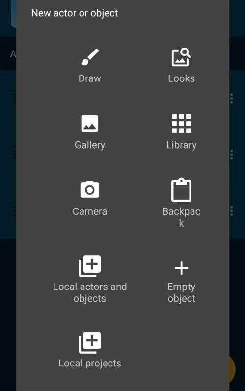

\
اضغط على زر الزائد لإضافة شخصية أو كائن جديد إلى مشروعك.\
[افتح الصورة](../../../media/getting-started/FigurHinzufuegen.png)

في Pocket Code يمكنك إضافة شخصية أو كائن إلى مشروعك بطرق متعددة:

**رسم**: يمكنك إنشاء شخصيتك بنفسك باستخدام **Pocket Paint**. Pocket Paint برنامج رسم ([المزيد عن Pocket Paint](https://catrobat.org/pocket-paint/))

**المظاهر**: اختر واحدة من مجموعة شخصيات وكائنات جاهزة ([المزيد عن مكتبة الوسائط](../elements/medialibrary.md)).

**المعرض**: يمكنك اختيار صورة من معرض الصور في هاتفك الذكي.

**المكتبة**: في المكتبة ستجد شخصيات وكائنات مبرمجة بالفعل، أي أن لها برنامجًا نصيًا جاهزًا. يمكنك اختيارها إذا أردت استخدام عناصر جاهزة في لعبتك (مثل العداد التنازلي) ([المزيد عن المكتبة](../elements/medialibrary.md#إضافة-كائن-من-مكتبة-الوسائط)).

**الكاميرا**: يمكنك استخدام كاميرا جهازك لالتقاط صورة وإضافتها كشخصية.

**حقيبة الظهر**: حقيبة الظهر فارغة حاليًا. يمكنك إعادة استخدام الشخصيات أو الكائنات التي خزنتها في حقيبة الظهر. سيُفرّغ البرنامج النصي كاملًا معها ([المزيد عن حقيبة الظهر](../elements/backpack.md)).

**الشخصيات والكائنات المحلية**: هنا ستجد شخصيات جاهزة يمكنك استخدامها في مشروعك. تعمل الشخصيات والكائنات المحلية كمكتبة وسائط بلا اتصال بالإنترنت، أي أنك تستطيع الوصول إليها حتى بدون اتصال بالإنترنت.

**كائن فارغ**: أضف كائنًا فارغًا، وهو كائن ليس له شكل ظاهر. يمكنك برمجة هذا الكائن بالطريقة المعتادة.

**المشاريع المحلية**: اختر مشروعًا تريد إدخال أول شخصية منه مع برنامجها النصي إلى مشروعك.

\
في Pocket Code يمكنك إضافة شخصية أو كائن إلى مشروعك بطرق متعددة.\
[افتح الصورة](../../../media/getting-started/NewActor-e1732794461668.jpg)
