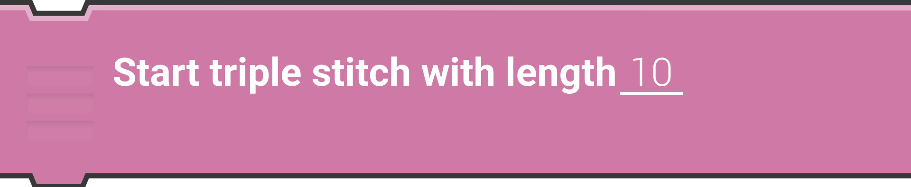

Üçlü dırnaq hər dırnaq üçün üç dəfə toxunur.

Üçlü toxuma ilk toxumanın ardından geri atlayır, toxumlar, sonra yenidən irəli atlayır və yenidən toxumlar.

Bu [sürən tik](running-stitch.md) ilə eyni işləyir.

Bu, toxuma daha uzun müddət davam edəcək.

