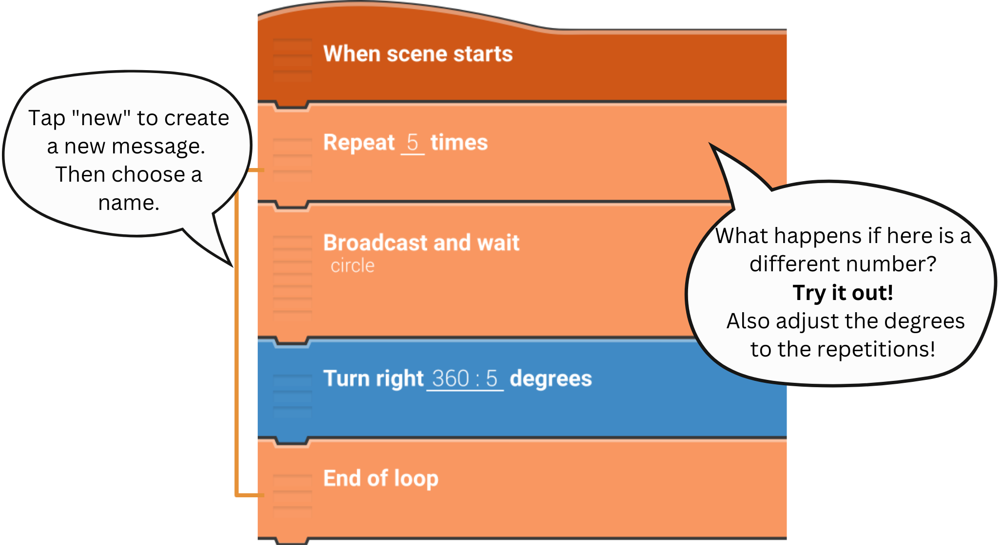

Bu dərsdə çiçəkləri necə tikməyi öyrənəcəksiniz (73 x 74,2 mm).

Bir döngənin nə olduğunu və necə işlədiyini artıq bilməlisiniz.

**[Dairə](../embroidery-tutorials-beginner/circle.md)**-tutorial bu dərs üçün faydalı ola bilər.

Əgər hələ heç nəyi tikməmisinizsə, [Başlayanlar](../embroidery-tutorials-beginner/index.md) seriyasındaki tikinti təlimatlarına baxın.

Daha çox məlumat və ya dizayn təklifləri üçün digər dərsliklərə baxın.

*Burada PDF formatında dərslik yükləyə bilərsiniz*:

[Çiçək](../../../media/embroidery-tutorials/Flower.pdf)

### 1. Yeni bir tikmə obyekti yaratın (Baqın [Dərsləmə obyektləri yaratın](../embroidery-tutorials-beginner/create-embroidery-objects.md)) və aşağıdakı skriptləri daxil edin:

### 2. Əsas quruluş

### 3. Çərçivələr

Bu hissə hər dəfə zəng olunur dairə mesajı göndərildi. Bunu da ssenarinizə əlavə edin.

### 4. Dizaynınızı başlamaq üçün oynamağa basın!
