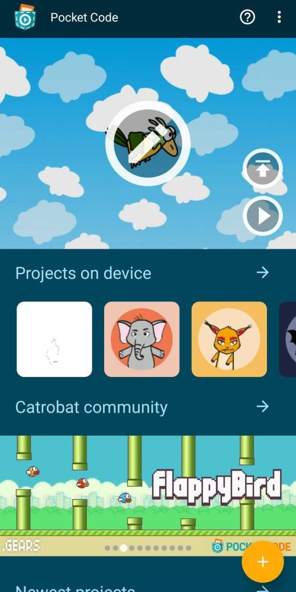

Когато стартираш Pocket Code, виждаш следния главен екран.

В горния десен ъгъл има символ , който те отвежда към документацията на Catrobat, в която има полезни съвети за теб.

До него е менюто . Оттам лесно можеш да отидеш в настройките, където можеш да смениш езика или да включиш разширения, например блоковете за плотер и други.

Под тях виждаш последния проект, който си редактирал. Натисни иконата за редактиране , за да отвориш изгледа на проекта, където можеш да продължиш да работиш по него.

Използвай бутона за пускане , за да стартираш проекта си.

Като натиснеш „Проекти на устройството“, имаш достъп до запазените си проекти. 

Ако искаш да опознаеш и да работиш по още проекти на други потребители, просто натисни „Catrobat Community“ в Share. Там ще намериш много чудесни проекти. 

Ако искаш да създадеш нов проект, натисни символа плюс. 
