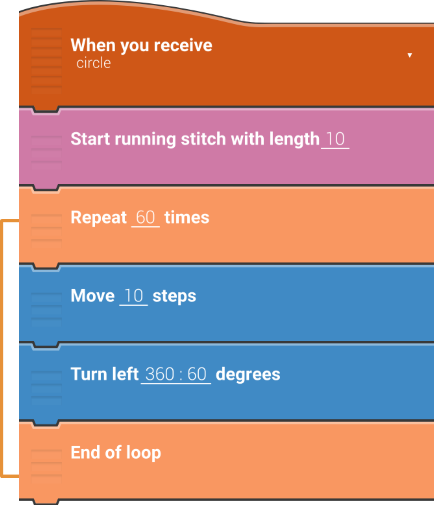

এই টিউটোরিয়ালটিতে, তুমি শিখবে কিভাবে একটি ফুল (73 x 74.2mm) বোনা হয়।

তোমার ইতিমধ্যে জানা উচিত একটি লুপ কি এবং কিভাবে এটি কাজ করে।

**[বৃত্ত](../embroidery-tutorials-beginner/circle.md)**-টিউটোরিয়াল এই টিউটোরিয়ালের জন্য সহায়ক হতে পারে।

তুমি যদি এখনও কিছু বোনা না থাকেন তবে [শুরু](../embroidery-tutorials-beginner/index.md) সিরিজের বোনা টিউটোরিয়ালগুলি দেখো।

আরো তথ্য বা নকশা পরামর্শের জন্য অন্যান্য টিউটোরিয়ালগুলি দেখো।

*এখানে তুমি PDF-ফরম্যাটে টিউটোরিয়ালটি ডাউনলোড করতে পারো*:

[ফুল](../../../media/embroidery-tutorials/Flower.pdf)

### 1. একটি নতুন ব্রোডিং অবজেক্ট তৈরি করো (দেখো [বোনা বস্তু তৈরি করো](../embroidery-tutorials-beginner/create-embroidery-objects.md)) এবং নিম্নলিখিত স্ক্রিপ্টগুলি সন্নিবেশ করানঃ:

### 2. মৌলিক কাঠামো

### 3. বৃত্ত

এই অংশটি প্রতিবার ডাকা হয় যখনই বৃত্ত বার্তা পাঠানো হয়। এটা তোমার স্ক্রিপ্টের মধ্যেও যোগ করো।

### 4. তোমার নকশা শুরু করার জন্য খেলার ট্যাপ করো!
