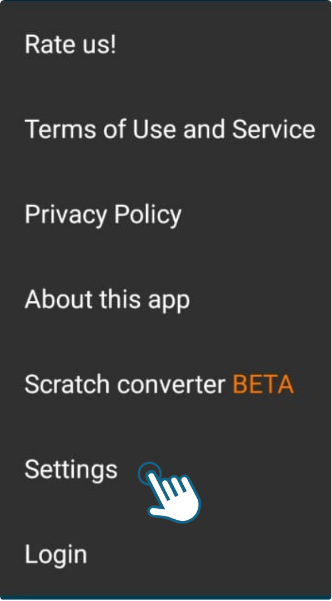

U ovom nastavku, aktiviranje broderija blokovi koda će biti objasnjen.

Ne treba ti znanje programiranja za ovo. Ovo je prvi korak da počnemo sa nastavima o ukrašenju. Kasnije možeš da dizajnirate, programirate i čak ukrašite sopstveni dizajn na omiljeni tekstilni komad.

Za više informacija ili predloge za dizajn pogledajte ostale nastavnike.

*Ovde možeš preuzeti tutorijal u PDF-formatu*:

[Aktiviraj broderiju](../../../media/embroidery-tutorials/ActivateEmbroideryBricks.pdf)

### 1. Pokrenite aplikaciju „Pocket Code“ i pratite klikove!

### 2. Otvori meni (točke na desnoj gornjoj strani).

### 3. Idi u „Podešavanja“.

### 4. Izbor „Proširenje za vez“.

### 5. Naći ćeš bloke broderijske kode kao sopstvenu kategoriju unutar vaših blokova koda!

Sada ćeš naći i sve broderijske blokove kodova među ostalim blokovima koda.

Za više informacija o svakom bloku koda, slobodno provjerite dokumentaciju blokova koda [-Hej, evo](../../../reference/) ili pratite u nastavku **[Blokovi za šavljenje](embroidery-bricks/index.md)**.

Sada možeš početi i kreirati sopstvene dizajne!

Ako vam treba ideja ili pomoć u tome, pogledajte ostale nastavnike ili nastavite sa **[Kreirajte objekte za ukras](create-embroidery-objects.md)** -učenje.
