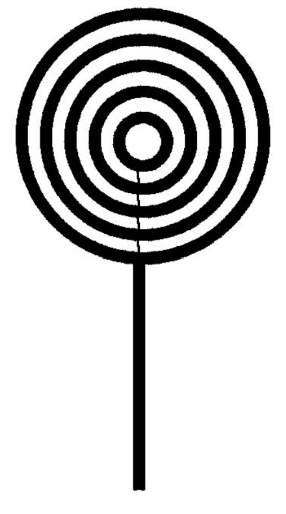

U ovom nastavku naučit ćeš kako da ukrašite štap (124,6 x 65,6 mm).

Trebao bi već znati šta je to i kako funkcioniše.

**[Krug](../embroidery-tutorials-beginner/circle.md)**-vodič može biti korisno za ovaj vodič.

Pogledajte nastavke za ukras u seriji [Početak](../embroidery-tutorials-beginner/index.md) ako još niste ukrasili ništa.

Za više informacija ili predloge za dizajn pogledajte ostale nastavnike.

*Ovde možeš preuzeti tutorijal u PDF-formatu*:

[LollipopPro](../../../media/embroidery-tutorials/LollipopPro.pdf)

### 1. Ugrađite novi objekat za ukras (vidi [Kreirajte objekte za ukras](../embroidery-tutorials-beginner/create-embroidery-objects.md)) i ubacite sledeće skripte:

### 2. Osnovna struktura

### 3. Krugovi

Ovaj deo se zove svaki put kada je poruka krug poslata. Dodaj to i u scenarij.

### 4. Klikni na igru da biste započeli dizajn!
