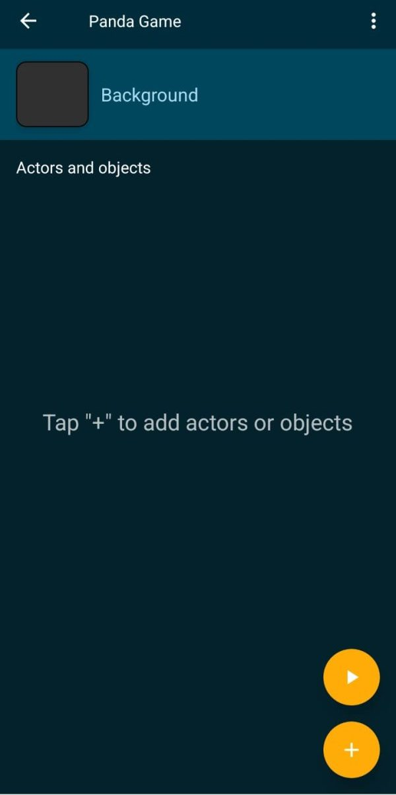

Otvori aplikaciju na telefonu ili tabletu.

\
Dodirni znak + da napraviš novi projekat.\
[Otvori sliku](../../../media/getting-started/MainScreen_NewProject.png)

Daj projektu ime (1). Izaberi hoće li ekran igre biti uspravan (portret) ili položen (pejzaž) (2).

\
Zatim dodirni kvačicu da potvrdiš (3).\
[Otvori sliku](../../../media/getting-started/NewProject.png)

Sad si u svom projektu. Na vrhu, vidiš ime svoje igre.

Ispod možeš vidjeti **Pozadina** - trenutno, pozadin je prazan. Ako želiš da ga promenimo, pritisni na njega.

U pozadini vidite područje za svoj **akteri i objekti** koji ste dodali u svoju igru. Trenutno je područje još uvek prazno.

U donjem desnom dijelu vidite dva važna dugmeta:

\
Sa dugmom **Pokreni** počinješ igru.

\
Sa dugmom **Plus,** dodate novi lik/objekt u igru.

\
Sad si u svom projektu.\
[Otvori sliku](../../../media/getting-started/ProjectScreen-1-e1732694778782.jpg)
