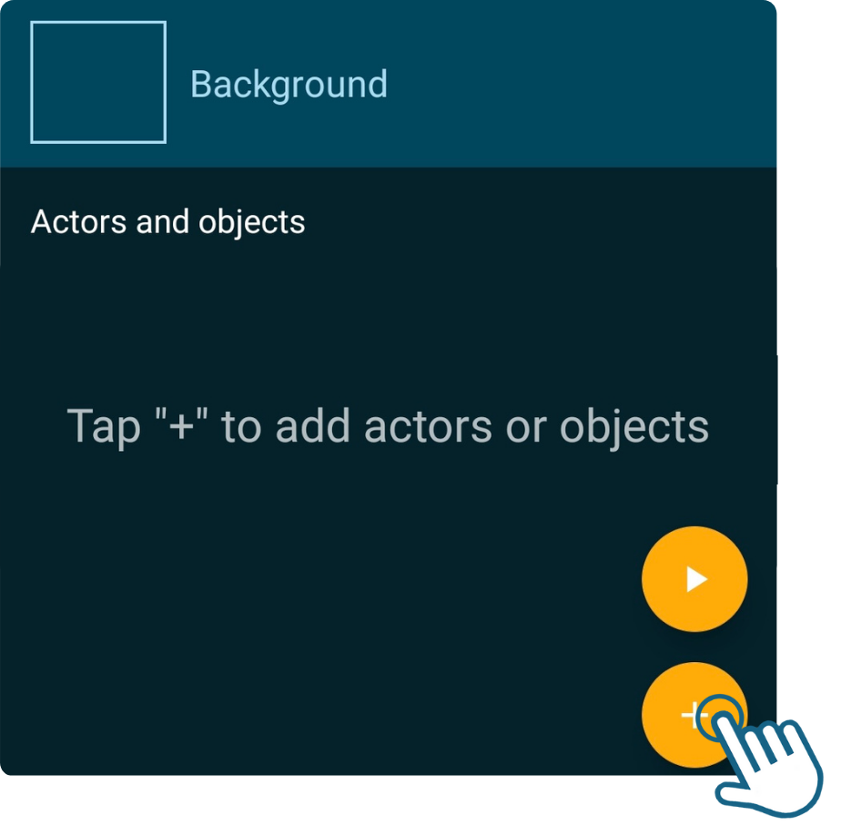

V tomto návodu se naučíš vytvořit objekty, pomocí kterých budeš později vyšívat své vzory.

K tomuto návodu bys už měl umět vytvořit projekt. Pokud potřebuješ pomoct, podívej se na návody z [úvodní série](../../game-tutorials/starter-tutorials/index.md).

Další informace nebo nápady na návrhy najdeš v ostatních návodech.

*Tady si můžeš stáhnout návod ve formátu PDF*:

[Vytvoř vyšívací objekty](../../../media/embroidery-tutorials/Create-Embroidery-Objects.pdf)

### 1. Klepni na tlačítko plus vpravo dole v projektu a přidej nový objekt.

### 2. Pro výběr obrázku otevři knihovnu médií.

### 3. Vyšívací objekt představuje jednu vrstvu jehly vyšívacího stroje. Několik vyšívacích objektů se vyšije jeden za druhým. Díky tomu můžeš použít několik barev.

Objekt si vyber podle barvy, kterou chceš.

Přejeď prstem dolů a najdi vhodnou šipku.

### 4. Dej svému novému objektu vhodné jméno a stiskni OK.

### 5. Vytvořil jsi nový objekt. Teď můžeš přidat skript a naprogramovat objekt.

Teď už víš, jak vytvořit objekt. Pro každou barvu, kterou chceš použít, přidej nový objekt.

Do každého objektu můžeš přidat skript a naprogramovat tak svůj vlastní návrh a později ho i vyšít.

Potřebuješ inspiraci nebo pomoc? Podívej se na ostatní návody!
