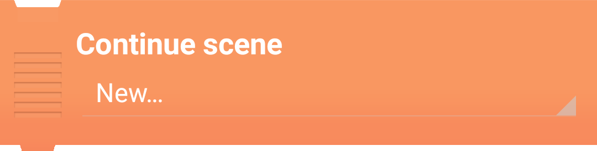

Tento blok obnoví scénu tam, kde byla pozastavená. Pokud byla scéna přerušená pauzou nebo čekáním, tento blok naváže přesně tam, kde se přestalo.

Představ si, že jsi pozastavil hru nebo animaci a teď chceš, aby zase běžela. Tento blok funguje jako tlačítko „přehrát“ a všechno se obnoví od místa, kde se zastavilo.
