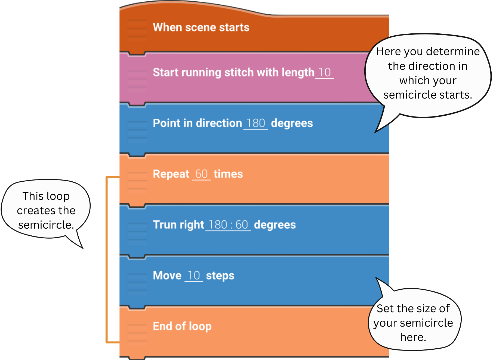

I denne vejledning lærer du at brodere en halvcirkel (37,2 x 76,2 mm).

Du skal allerede vide, hvordan man laver et nyt objekt og indsætter klodser i det. Kig gerne på vejledningerne i [Startserien](../../game-tutorials/starter-tutorials/index.md), hvis du stadig har brug for hjælp. Desuden skal broderiklodserne være aktiveret. Du kan finde ud af, hvordan det gøres, i vejledningen **[Aktivér broderiklodser](activate-embroidery-bricks.md)**.

For mere information eller designforslag kan du tjekke de andre vejledninger.

*Her kan du downloade vejledningen i PDF-format*:

[Halvcirkel](../../../media/embroidery-tutorials/Semicircle.pdf)

### 1. Lav et nyt broderiobjekt (se [Lav broderiobjekter](create-embroidery-objects.md)).

### 2. Start nu, og indsæt klodserne trin for trin i dit script.

### 3. Tryk på afspil for at starte dit design!

Du skal angive rotationsgraden, her som 180 ÷ 60.

180 forbliver altid det samme for en halvcirkel! Du skal derfor vælge antallet af gentagelser passende, her 60. **Prøv andre kombinationer!** For eksempel: 30 og 360 ÷ 30 eller 120 og 360 ÷ 120.

Prøv også at brodere en kvartcirkel (hint: 90 grader) eller andre variationer.

