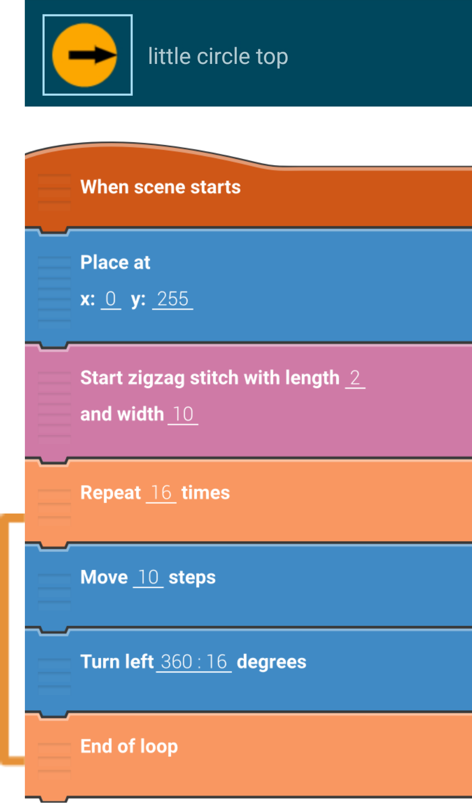

I denne vejledning lærer du at brodere Yin og Yang (78,4 x 78,4 mm).

Du skal allerede vide, hvad en løkke er, og hvordan den virker.

Vejledningen **[Cirkel](../embroidery-tutorials-beginner/circle.md)** kan være nyttig til denne vejledning.

Kig på broderivejledningerne i [Begynder-serien](../embroidery-tutorials-beginner/index.md), hvis du endnu ikke har broderet noget.

For mere information eller designforslag er du velkommen til at kigge på de andre vejledninger.

*Her kan du downloade vejledningen i PDF-format*:

[Yin og Yang](../../../media/embroidery-tutorials/Yin-and-Yang.pdf)

### 1. Lav et nyt broderiobjekt (se [Lav broderiobjekter](../embroidery-tutorials-beginner/create-embroidery-objects.md)):

### 2. Indsæt følgende script for den store cirkel:

### 3. Midterkurve

Tilføj også denne del til dit script:

### 4. Øverste lille cirkel

Lav et nyt broderiobjekt, og indsæt følgende script:

### 5. Kopiér den lille cirkel

Du kan bare kopiere objektet fra trin 4:

### 6. Nederste lille cirkel

Du skal ændre positionen af den anden cirkel:

### 7. Tryk på afspil for at starte dit design!

