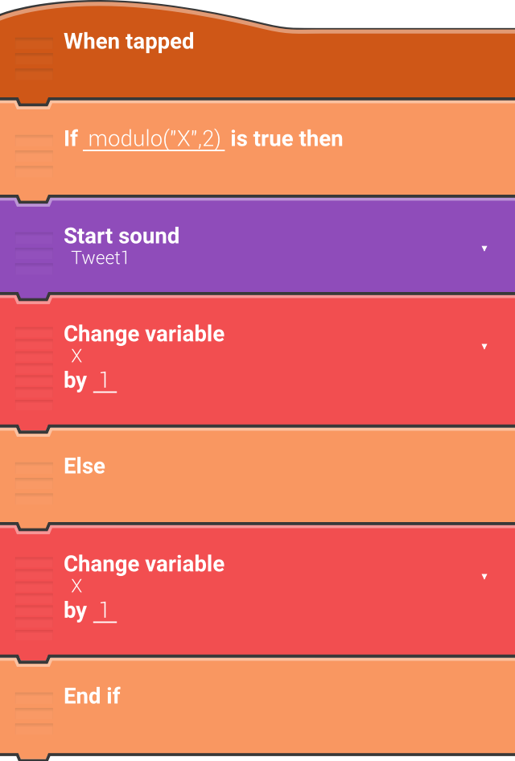

*Tjekker, om en betingelse er sand, og kører ét sæt instruktioner, hvis den er, og et andet sæt, hvis den ikke er. Det er som at give to muligheder: “Hvis dette er sandt, så gør det her; ellers gør noget andet.”*

Når scenen starter, sættes variablen X til 0.

Hvis dyret nu bliver trykket på, tjekkes det, om X modulo 2 er sand, altså om X er et ulige tal.

Hvis det er tilfældet, afspilles lyden Tweet1, og variablen X øges med 1.

Ellers, hvis X er lige, øges X kun med 1.

Instruktionerne, der skal køres, adskilles med en Slut på hvis.
