*Mit Steuerungsbausteinen kannst du den Ablauf deines Programms steuern. Der Programmablauf kann z.B. mit Wenn-Dann-Abfragen oder Schleifen gesteuert werden.*

[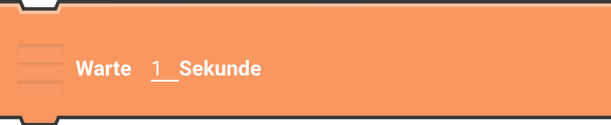](../reference/bricks/WaitBrick.md)

[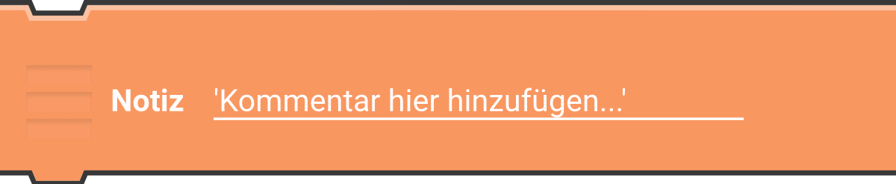](../reference/bricks/NoteBrick.md)

[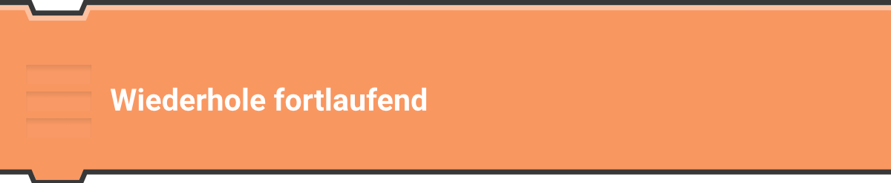](../reference/bricks/ForeverBrick.md)

[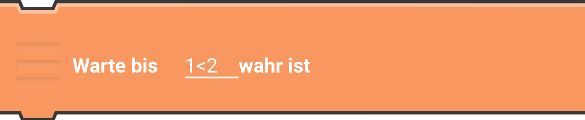](../reference/bricks/WaitUntilBrick.md)

[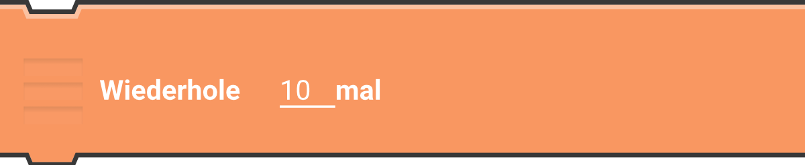](../reference/bricks/RepeatBrick.md)

[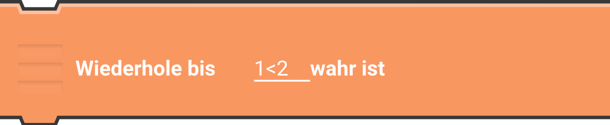](../reference/bricks/RepeatUntilBrick.md)

[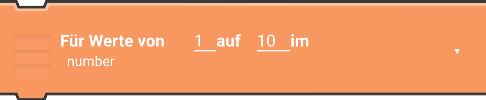](../reference/bricks/ForVariableFromToBrick.md)

[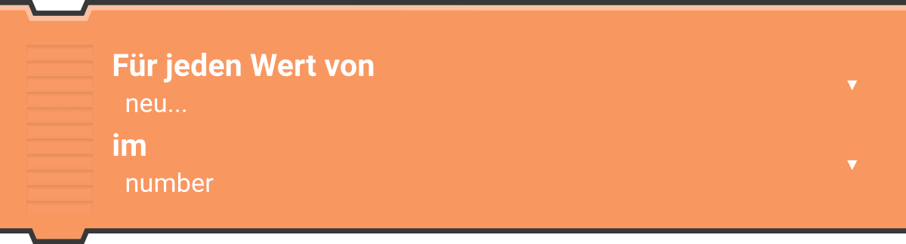](../reference/bricks/ForItemInUserListBrick.md)

[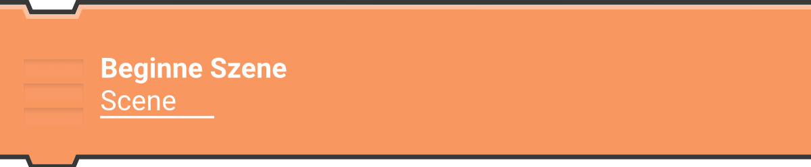](../reference/bricks/SceneStartBrick.md)

[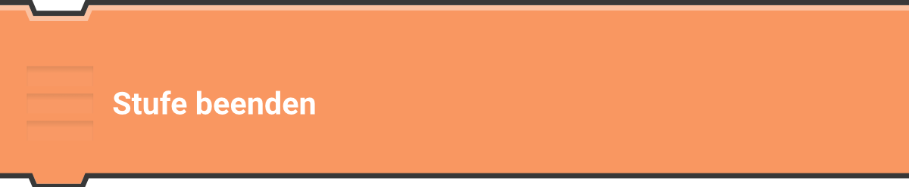](../reference/bricks/FinishStageBrick.md)

[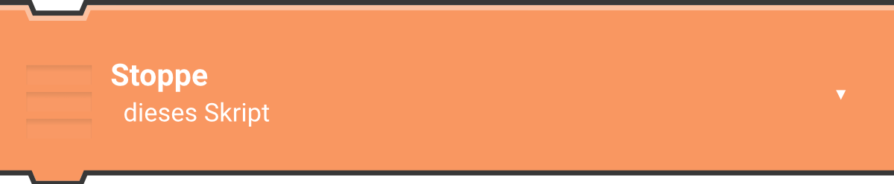](../reference/bricks/StopScriptBrick.md)

[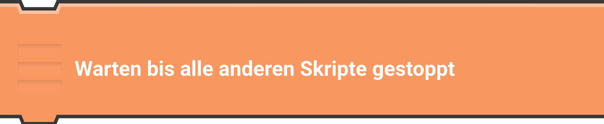](../reference/bricks/WaitTillIdleBrick.md)

[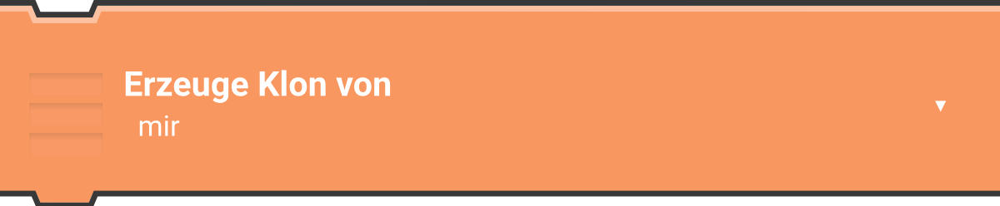](../reference/bricks/CloneBrick.md)

[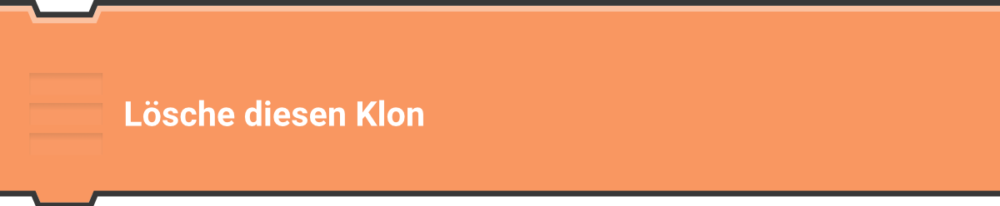](../reference/bricks/DeleteThisCloneBrick.md)

[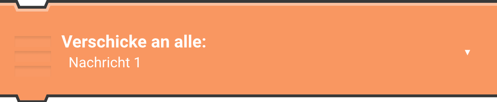](../reference/bricks/BroadcastBrick.md)

[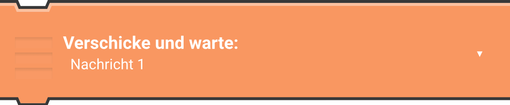](../reference/bricks/BroadcastWaitBrick.md)
