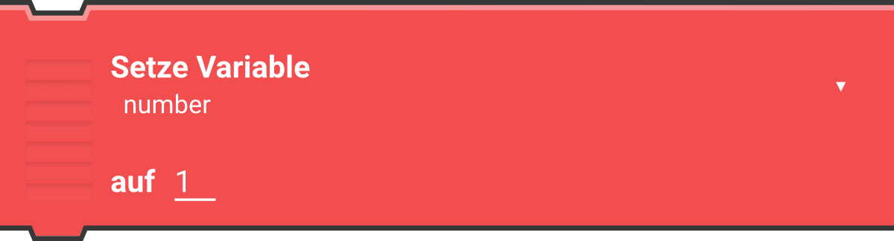
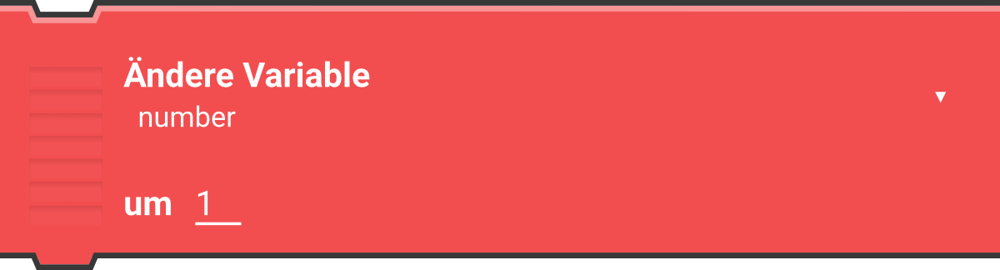
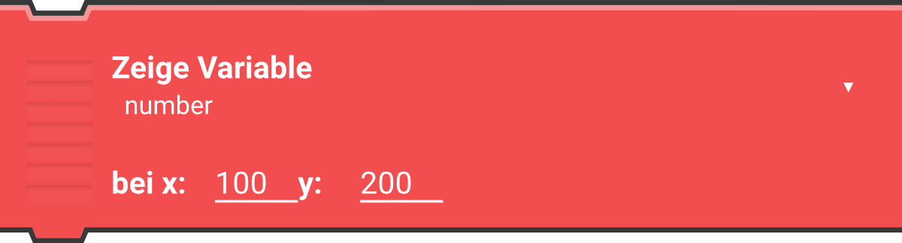
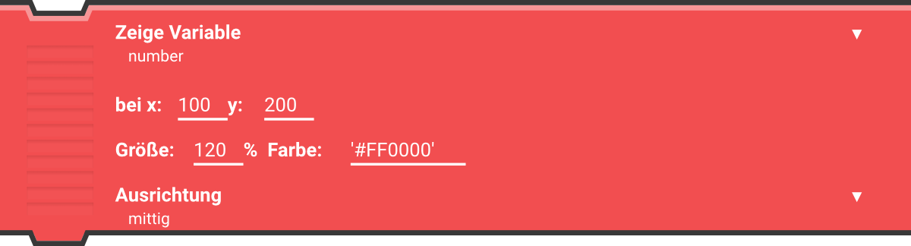
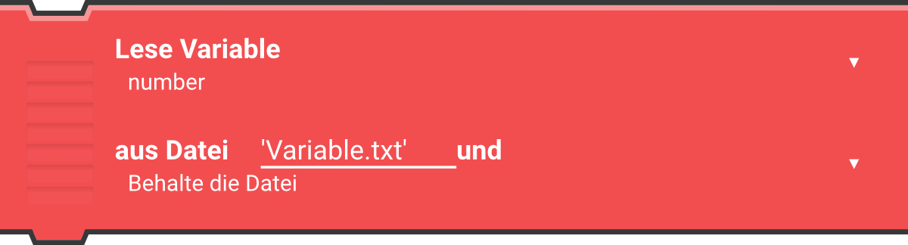

*Daten-Bausteine sind sehr hilfreich, um Daten wie Variablen und Listen, z.B. Highscores oder Einstellungen, zu speichern und zu verwalten. Du kannst Daten auch dauerhaft speichern und somit z.B. Spielstände sichern.*

