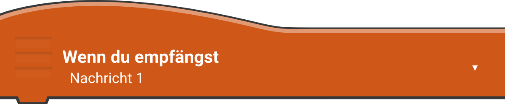

*Jedes neue Skript beginnt mit einem Ereignisbaustein. Ereignis Bricks definieren, **wann** ein Skript starten soll. Jeder Baustein nach dem Ereignis wird folglich ausgeführt und sagt dem Programm, was es tun soll. Unterschiedliche Startpunkte lösen unterschiedliche Ereignisse aus.*

