Aussehen-Bausteine betreffen hauptsächlich das Aussehen eines Objekts bzw. einer Figur. Mit diesen Bausteinen kann das Aussehen einer Figur angepasst, grafische Effekte sowie Denk- und Sprechblasen verwendet werden.

[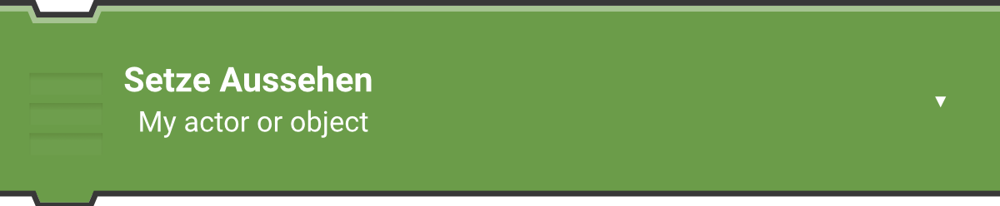](../reference/bricks/SetLookBrick.md)

[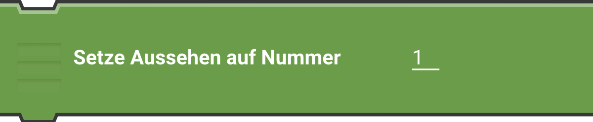](../reference/bricks/SetLookByIndexBrick.md)

[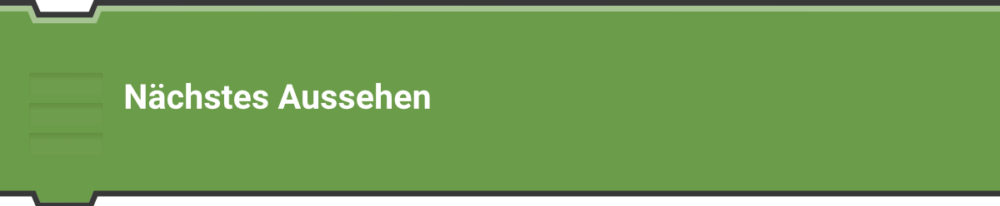](../reference/bricks/NextLookBrick.md)

[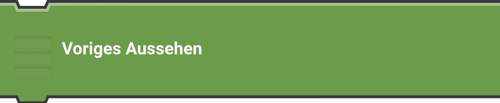](../reference/bricks/PreviousLookBrick.md)

[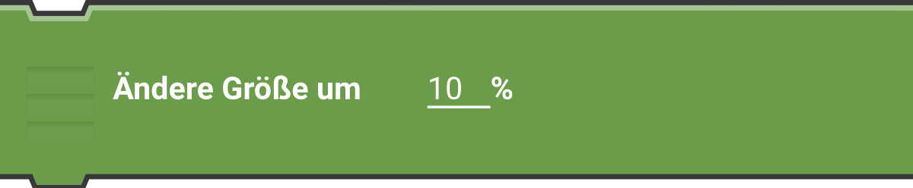](../reference/bricks/ChangeSizeByNBrick.md)

[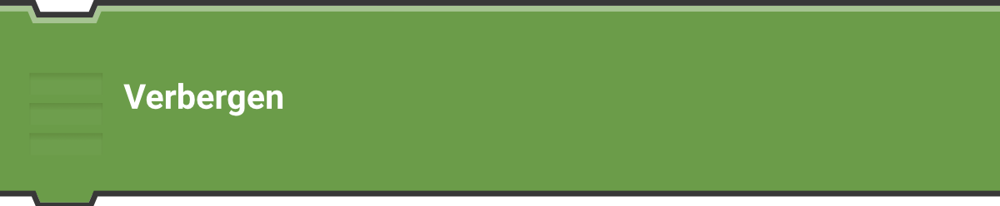](../reference/bricks/HideBrick.md)

[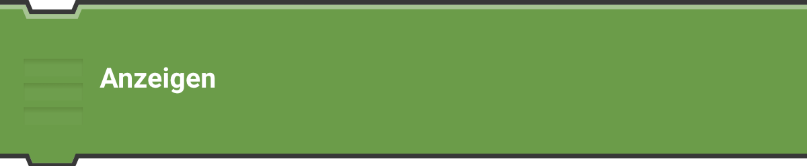](../reference/bricks/ShowBrick.md)

[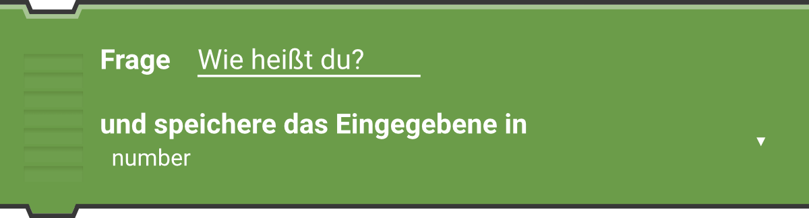](../reference/bricks/AskBrick.md)

[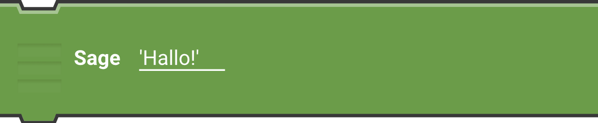](../reference/bricks/SayBubbleBrick.md)

[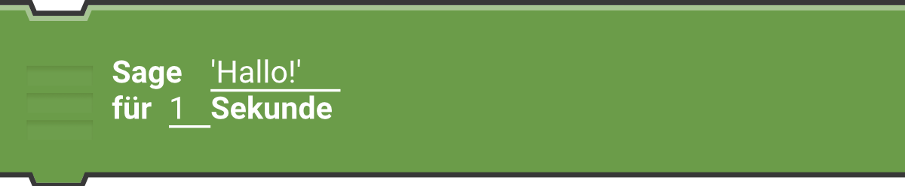](../reference/bricks/SayForBubbleBrick.md)

[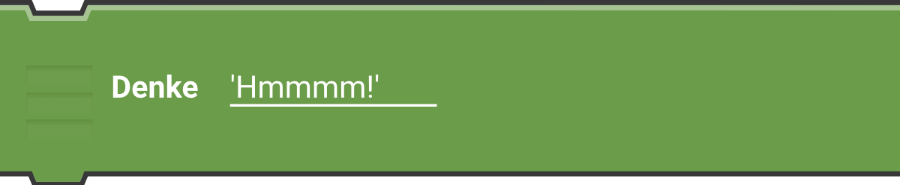](../reference/bricks/ThinkBubbleBrick.md)

[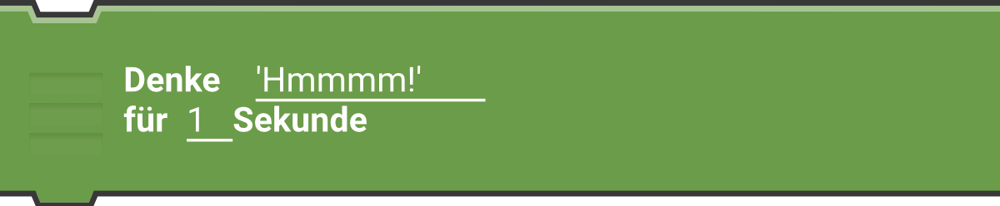](../reference/bricks/ThinkForBubbleBrick.md)

[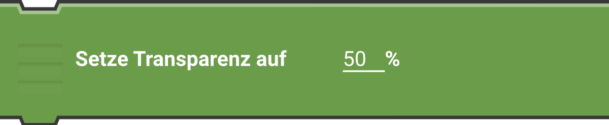](../reference/bricks/SetTransparencyBrick.md)

[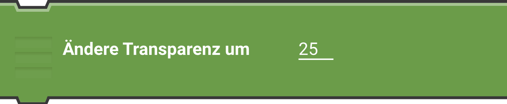](../reference/bricks/ChangeTransparencyByNBrick.md)

[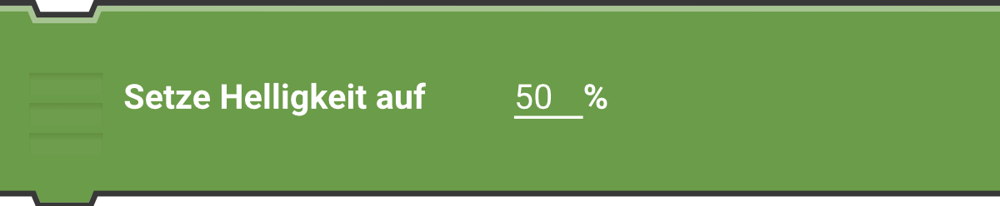](../reference/bricks/SetBrightnessBrick.md)

[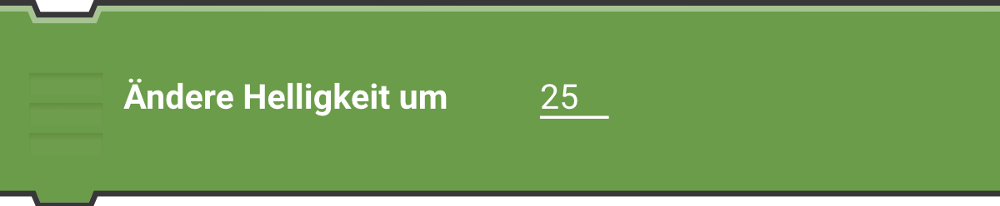](../reference/bricks/ChangeBrightnessByNBrick.md)

[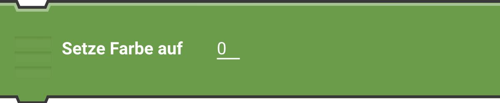](../reference/bricks/SetColorBrick.md)

[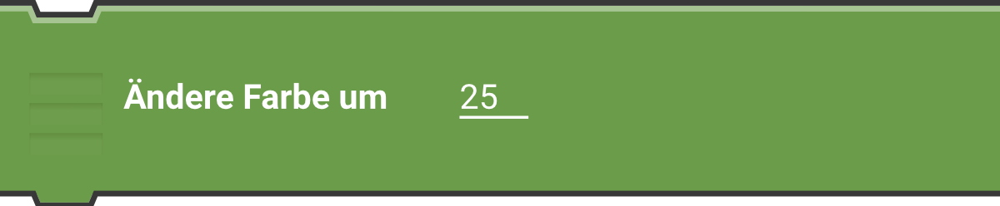](../reference/bricks/ChangeColorByNBrick.md)

[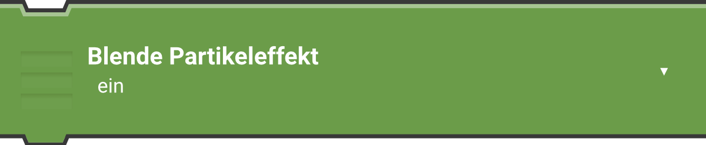](../reference/bricks/FadeParticleEffectBrick.md)

[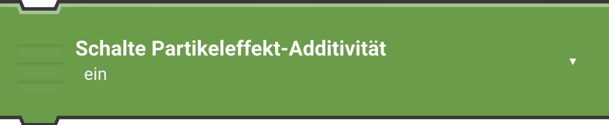](../reference/bricks/ParticleEffectAdditivityBrick.md)

[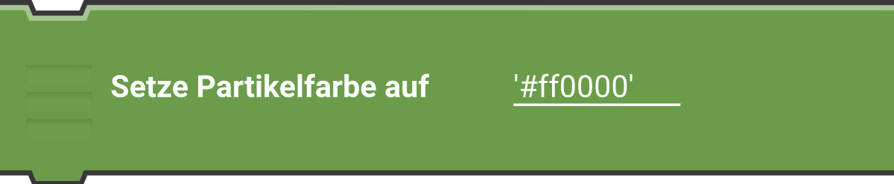](../reference/bricks/SetParticleColorBrick.md)

[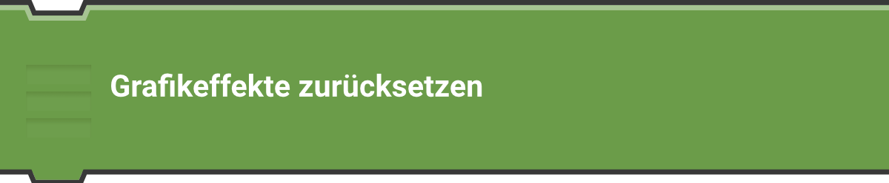](../reference/bricks/ClearGraphicEffectBrick.md)

[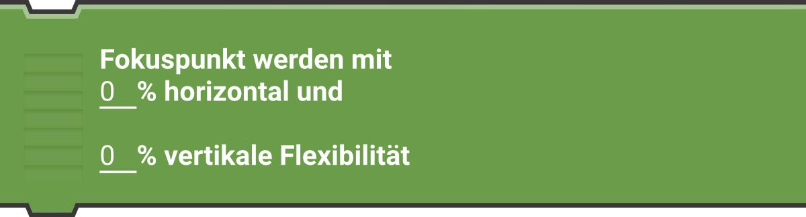](../reference/bricks/SetCameraFocusPointBrick.md)

[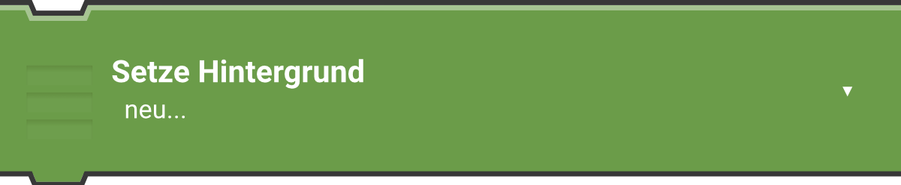](../reference/bricks/SetBackgroundBrick.md)

[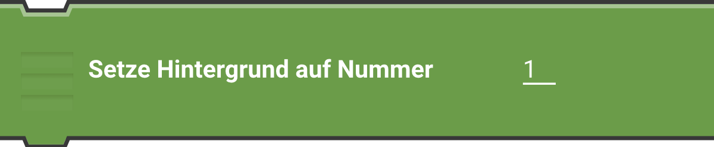](../reference/bricks/SetBackgroundByIndexBrick.md)

[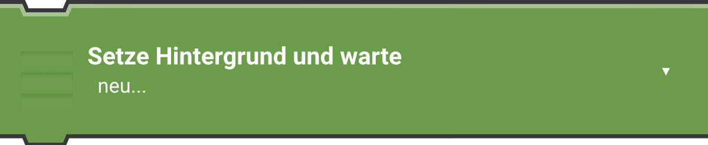](../reference/bricks/SetBackgroundAndWaitBrick.md)

[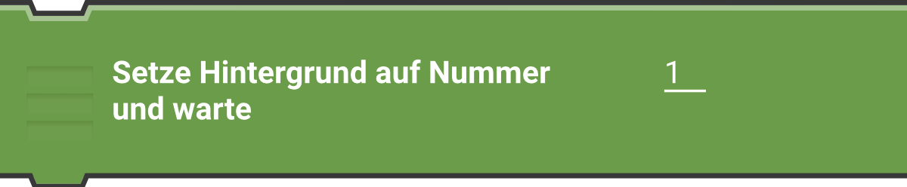](../reference/bricks/SetBackgroundByIndexAndWaitBrick.md)

[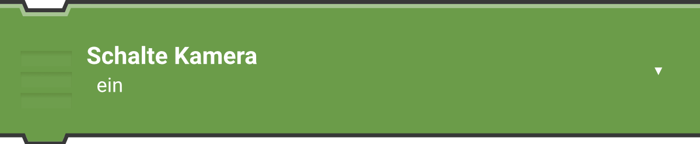](../reference/bricks/CameraBrick.md)

[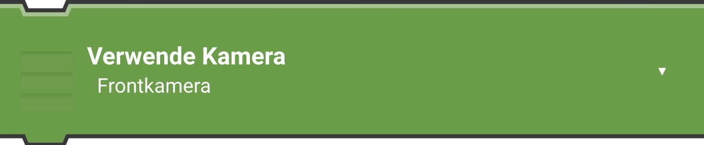](../reference/bricks/ChooseCameraBrick.md)

[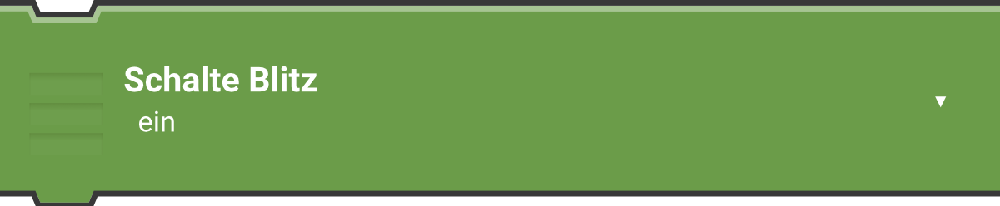](../reference/bricks/FlashBrick.md)

[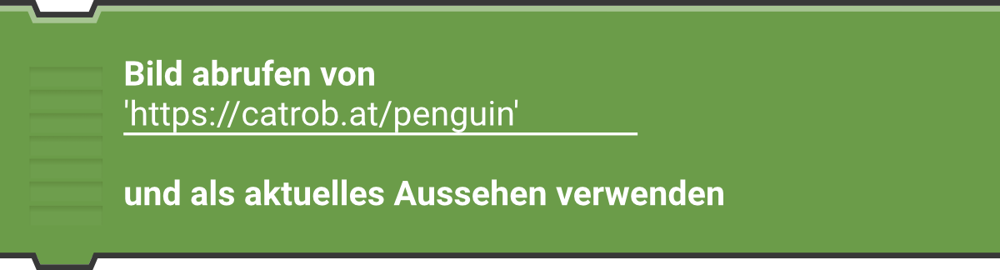](../reference/bricks/LookRequestBrick.md)

[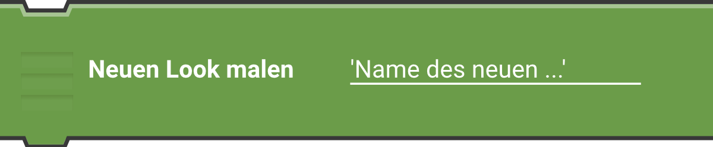](../reference/bricks/PaintNewLookBrick.md)

[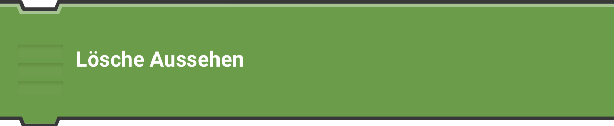](../reference/bricks/DeleteLookBrick.md)
