*Bewegungsblöscke werden verwendet, um die **Position, Richtung, Bewegung** und Physik von Objekten festzulegen. Die Position wird mit einem Koordinatensystem festgelegt, das der kartesischen Ebene ähnelt, wobei die x- und y-Achsen entlang der Mitte des Bildschirms verlaufen. Die Richtung wird mit der angegebenen Gradzahl festgelegt. Die Bewegung wird mit Schritten/Sekunde angegeben, wobei sich Schritte auf die von einem Sprite entlang der x- oder y-Achse zurückgelegte Strecke beziehen. Die Physik-Engine wendet unterdessen Reibung, Schwerkraft und unterschiedliche Bewegungsstile auf verschiedene Objekte an.*

[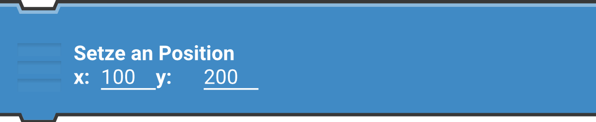](../reference/bricks/PlaceAtBrick.md)

[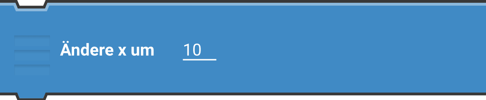](../reference/bricks/ChangeXByNBrick.md)

[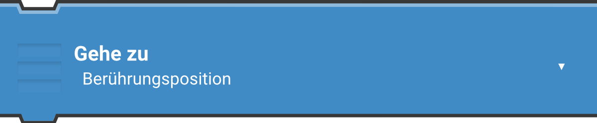](../reference/bricks/GoToBrick.md)

[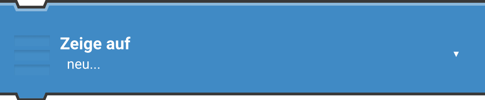](../reference/bricks/PointToBrick.md)

[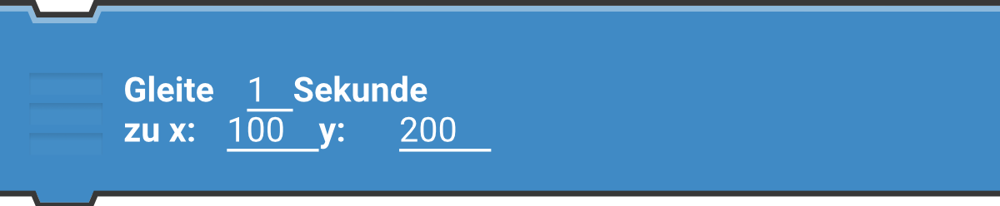](../reference/bricks/GlideToBrick.md)

[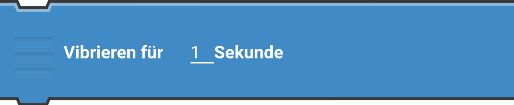](../reference/bricks/VibrationBrick.md)

[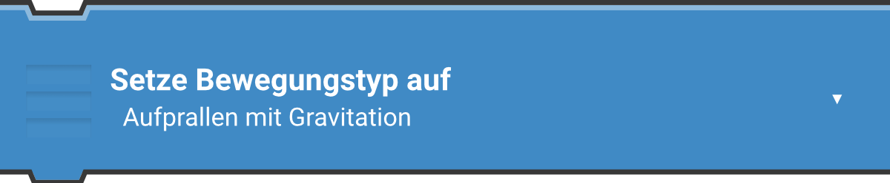](../reference/bricks/SetPhysicsObjectTypeBrick.md)

[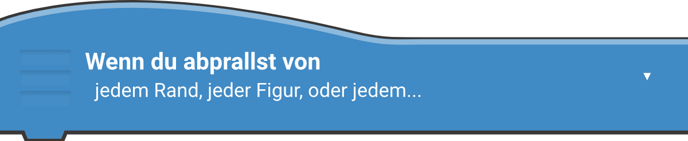](../reference/bricks/WhenBounceOffScript.md)

[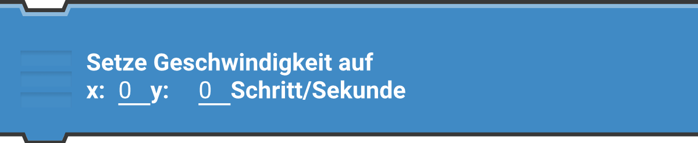](../reference/bricks/SetVelocityBrick.md)

[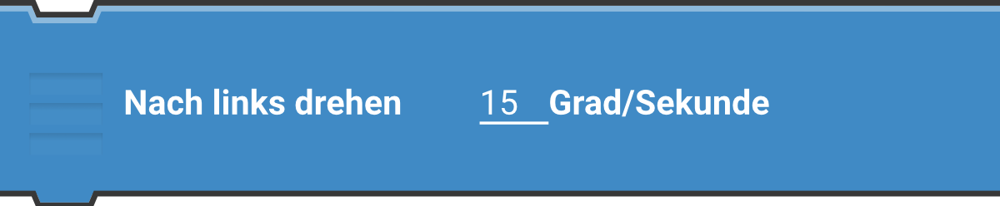](../reference/bricks/TurnLeftSpeedBrick.md)

[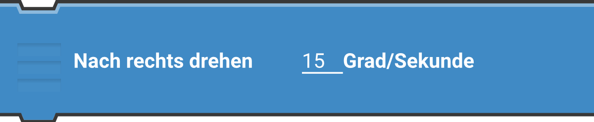](../reference/bricks/TurnRightSpeedBrick.md)

[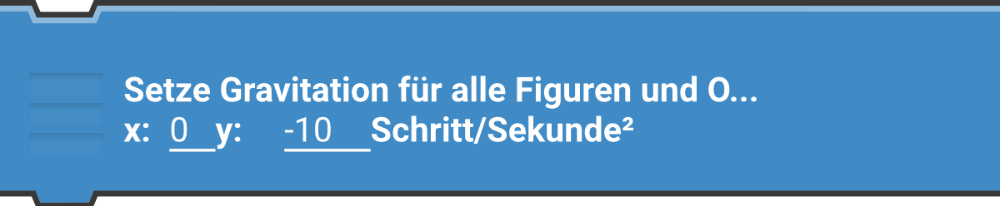](../reference/bricks/SetGravityBrick.md)

