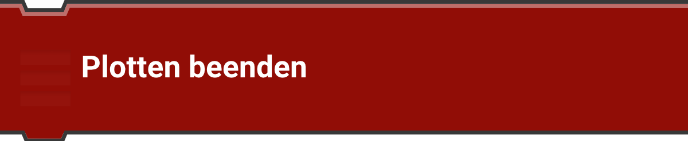
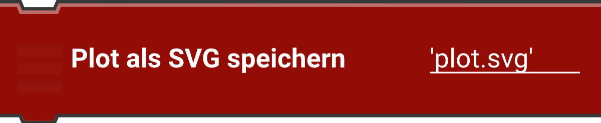

Die Plot Erweiterung in Pocket Code ermöglicht es dir, vektorbasierte Designs zu erstellen. Mit dieser Erweiterung kannst du SVG-Dateien erstellen, die an einen Plotter gesendet werden können, um Zeichnungen zu erstellen, Sticker zu schneiden oder Vinyl-Heat-Folien auf T-Shirts anzubringen.

Mit dem Schneideplotter kannst du auch deine Designs aus Papier oder Karton ausschneiden.

