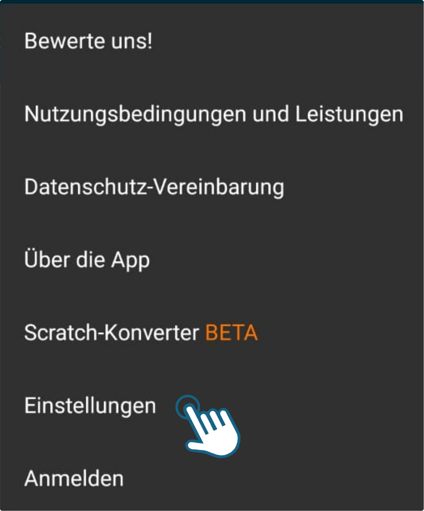
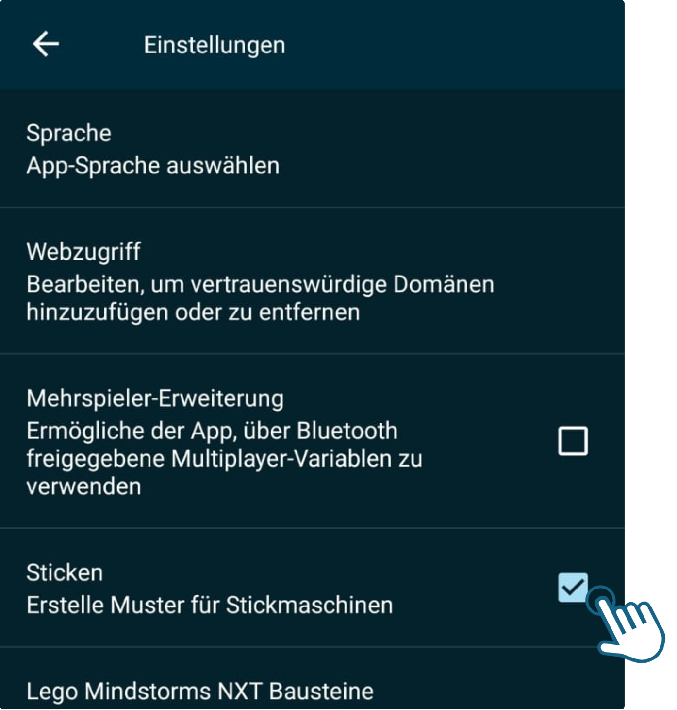

In diesem Tutorial wird erklärt, wie du die Stickbausteine aktivierst.

Du benötigst dafür keine Programmierkenntnisse. Dies ist der erste Schritt, um mit den Stick-Tutorials zu beginnen. Später kannst du deine eigenen Designs entwerfen, programmieren und sogar auf dein Lieblingskleidungsstück sticken.

Für mehr Informationen oder Designvorschläge schau dir doch auch die anderen Tutorials an.

*Hier kannst du das Tutorial im PDF-Format herunterladen:*

[Stickbausteine aktivieren](../../../media/embroidery-tutorials/Stickbausteine-aktivieren.pdf)

### 1. Starte die “Pocket-Code”-App. Folge den Klicks!

### 2. Öffne das Menü (die drei Punkte rechts oben im Eck).

### 3. Gehe zu “Einstellungen”.

### 4. Aktiviere den Punkt “Sticken”.

### 5. Du findest die Stick-Bausteine jetzt als eigene Kategorie bei den Bausteinen!

Jetzt findest du auch alle Stickbausteine bei den anderen Bausteinen.

Für weitere Informationen zu jedem Baustein kannst du dir die Dokumentation der Bausteine [hier](../../bricks/index.md) ansehen oder das Tutorial **[Stickbausteine](embroidery-bricks/index.md)** dazu machen.

Jetzt kannst du loslegen und deine eigenen Designs erstellen!

Wenn du Ideen oder Hilfe benötigst, schau dir die anderen Tutorials an oder mach mit dem **[Stickobjekte erstellen](create-embroidery-objects.md)** weiter.
