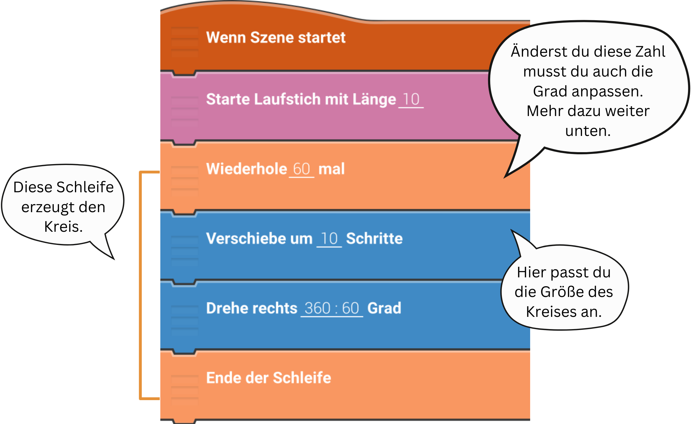

In diesem Tutorial erfährst du, wie du einen Kreis (76,2 x 76,2mm) sticken kannst.

Du solltest dafür schon wissen, wie man ein neues Objekt erstellt und dort Bausteine einfügt. Sieh dir gerne die Tutorials der [Starter-Reihe](../../game-tutorials/starter-tutorials/index.md) an, wenn du da noch Hilfe benötigst. Außerdem müssen die Stickbausteine schon aktiviert sein. Wie das geht erfährst du im Tutorial **[Stickbausteine aktivieren](activate-embroidery-bricks.md)**.

Für mehr Informationen oder Designvorschläge schau dir doch auch die anderen Tutorials an.

*Hier kannst du das Tutorial im PDF-Format herunterladen:*

[Kreis](../../../media/embroidery-tutorials/Kreis.pdf)

### 1. Erstelle zuerst ein neues Stick-Objekt (siehe Tutorial [Stickobjekte erstellen](create-embroidery-objects.md)).

### 2. Füge jetzt Schritt für Schritt die Bausteine zu deinem Skript hinzu:

### 3. Drücke auf den Play-Button um zu starten.

Du musst den Grad der Drehung festlegen, wie hier 360 ÷ 60.

360 bleibt dabei bei einem Kreis immer gleich! Du musst also die Wiederholungen passend einstellen, wie hier 60. **Probiere andere Kombinationen aus!** z.B.: 30 und 360 ÷ 30 oder 120 und 360 ÷ 120.
