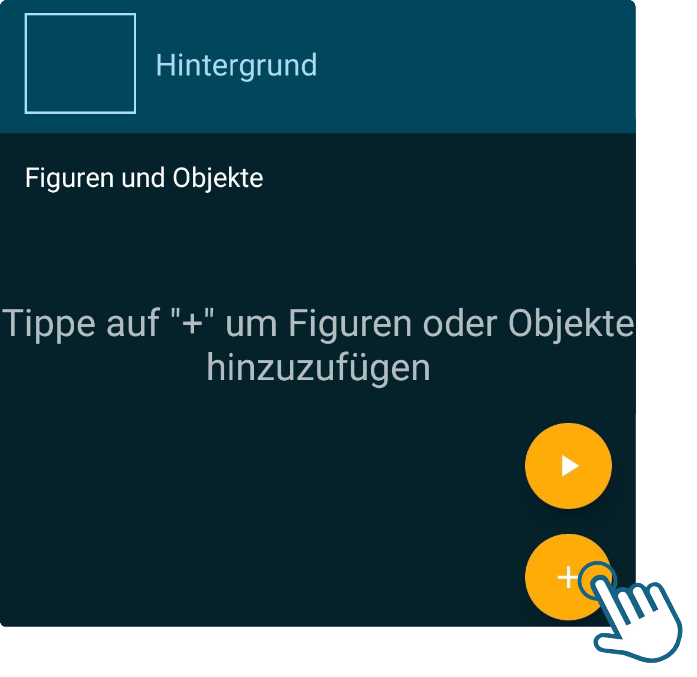
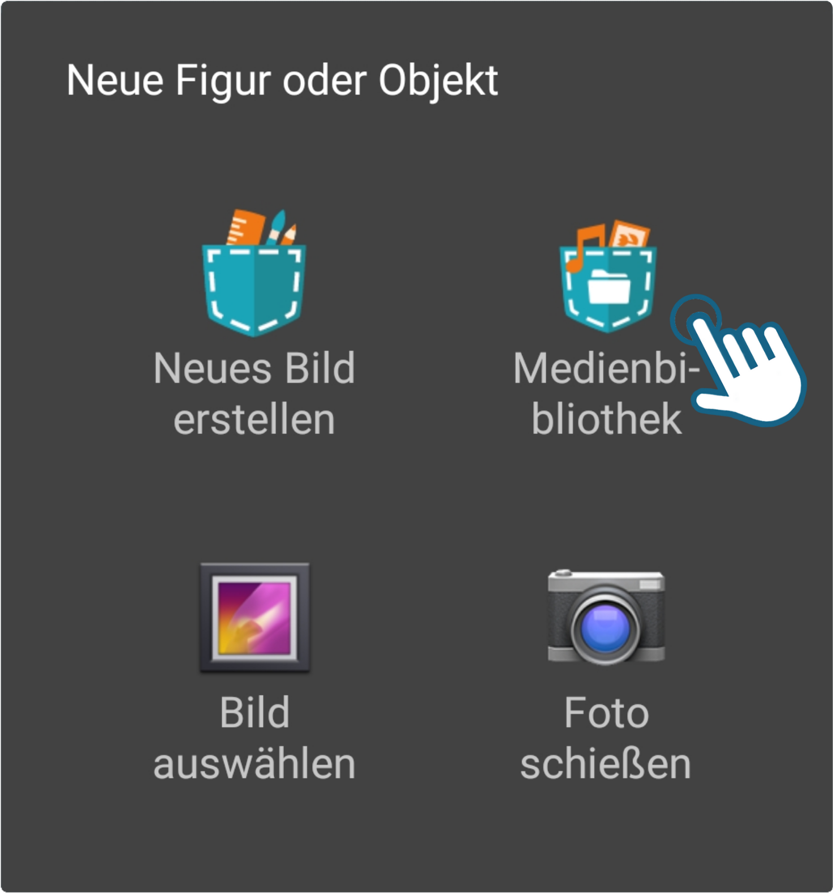
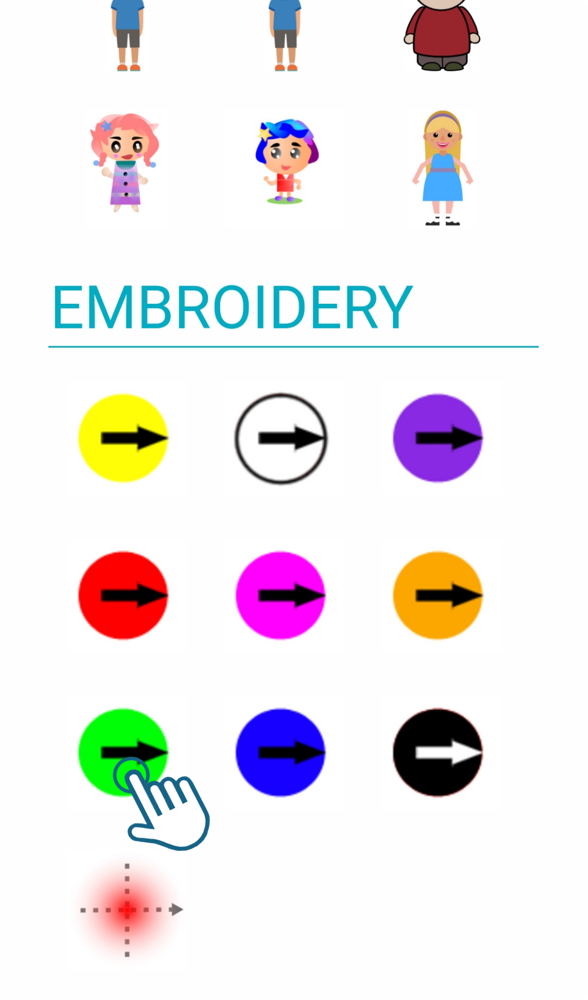
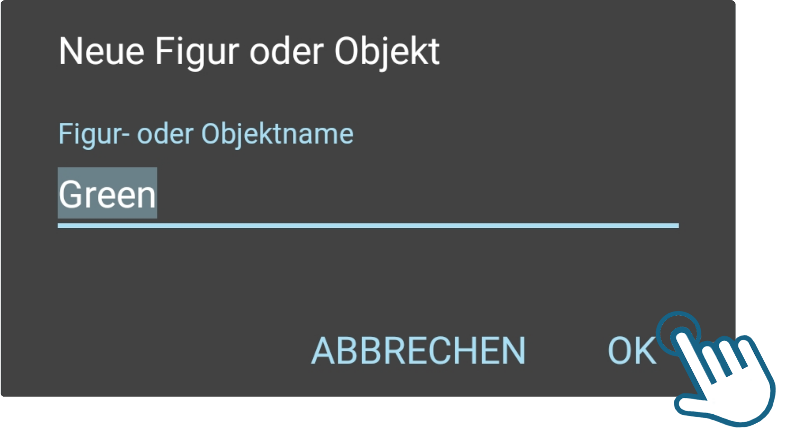
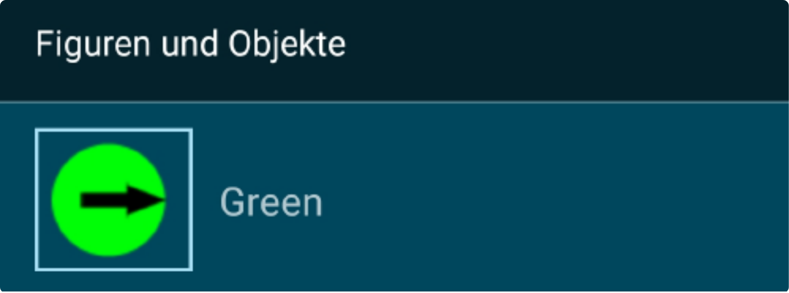

In diesem Tutorial lernst du, wie du Objekte erstellst, mit denen du später deine Muster sticken kannst.

Du solltest für dieses Tutorial bereits wissen, wie man ein Projekt erstellt. Schau dir dazu gerne die Tutorials aus der [Starter-Reihe](../../game-tutorials/starter-tutorials/index.md) an.

Für mehr Informationen oder Designvorschläge schau dir doch auch die anderen Tutorials an.

*Hier kannst du das Tutorial im PDF-Format herunterladen:*

[Stickobjekte erstellen](../../../media/embroidery-tutorials/Stickobjekte-erstellen.pdf)

### 1. Drücke in deinem Projekt auf den Plus-Button unten rechts, um ein neues Objekt hinzuzufügen.

### 2. Um ein Motiv zu wählen gehe in die Medienbibliothek.

### 3. Ein Stick-Objekt repräsentiert eine Ebene der Nadel der Stickmaschine. Mehrere Stick-Objekte werden nacheinander gestickt. Das ermöglicht es verschiedene Farben zu verwenden.

Du kannst je nach gewünschter Farbe dein Objekt auswählen.

Scrolle nach unten und suche dir den Pfeil in der passenden Farbe.

### 4. Gib deinem neuen Objekt einen passenden Namen und drücke auf OK.

### 5. Jetzt hast du ein neues Objekt erstellt. Du kannst jetzt ein Skript hinzufügen und das Objekt programmieren.

Jetzt weißt du wie man ein Objekt erstellt. Füge jetzt für jede Farbe, die du verwenden möchtest, ein neues Objekt hinzu.

Du kannst in jeder Farbe ein Skript hinzufügen und so dein ganz eigenes Muster programmieren und später sogar sticken.

Brauchst du Inspiration oder Hilfe? Schau dir doch gerne unsere weiteren Tutorials an
