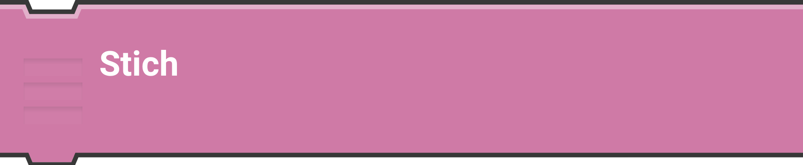
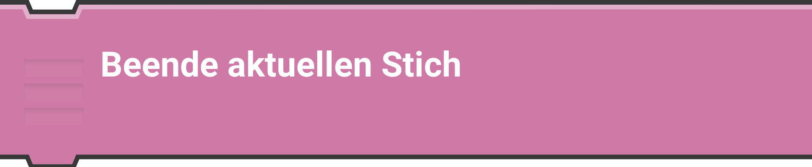

In diesem Tutorial lernst du alles, was du über die Stickbausteine wissen musst!

Dafür brauchst du keine Programmiererfahrung. Jeder Stickbaustein wird mit einem Beispiel erklärt.

Wenn du die Stickbausteine noch nicht aktiviert hast, schau dir das Tutorial **[Stickbausteine aktivieren](../activate-embroidery-bricks.md)** an.

*Hier kannst du das Tutorial im PDF-Format herunterladen:*

[Stickbausteine](../../../../media/embroidery-tutorials/Stickbausteine.pdf)

Klicke auf die verschiedenen Bausteine, um mehr über sie zu erfahren:

*Lässt die Stickmaschine einmal in den Stoff sticken.*

*Lässt die Stickmaschine laufend mit einer variablen Länge sticken.*

*Lässt mit einer variablen Länge und Breite im Zickzack sticken.*

*Funktioniert wie der Laufstich, vernäht aber jeden Stich dreimal.*

*Stoppt den aktuellen Lauf-, Zickzack- oder Dreifachstich.*

Weitere Stickbausteine und Informationen darüber findest du [hier](../../../bricks/embroidery.md).

Für mehr Informationen oder Designideen schau dir doch auch die anderen Tutorials an!
