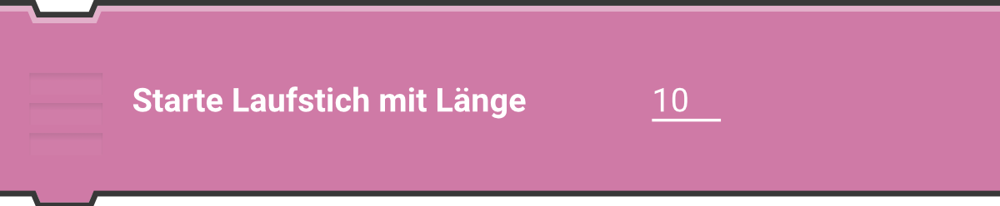
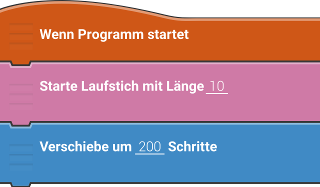

Lässt die Stickmaschine laufend mit einer variablen Länge sticken.

Die Maschine startet einen Laufstich der **alle 10 Schritte** sticht.

Dann wird **um 200 Schritte** verschoben.

Das ergibt **gesamt 20 Stiche**.

Der Laufstich erleichtert das Nähen einer Naht, da du keine Schleife mehr benötigst.

