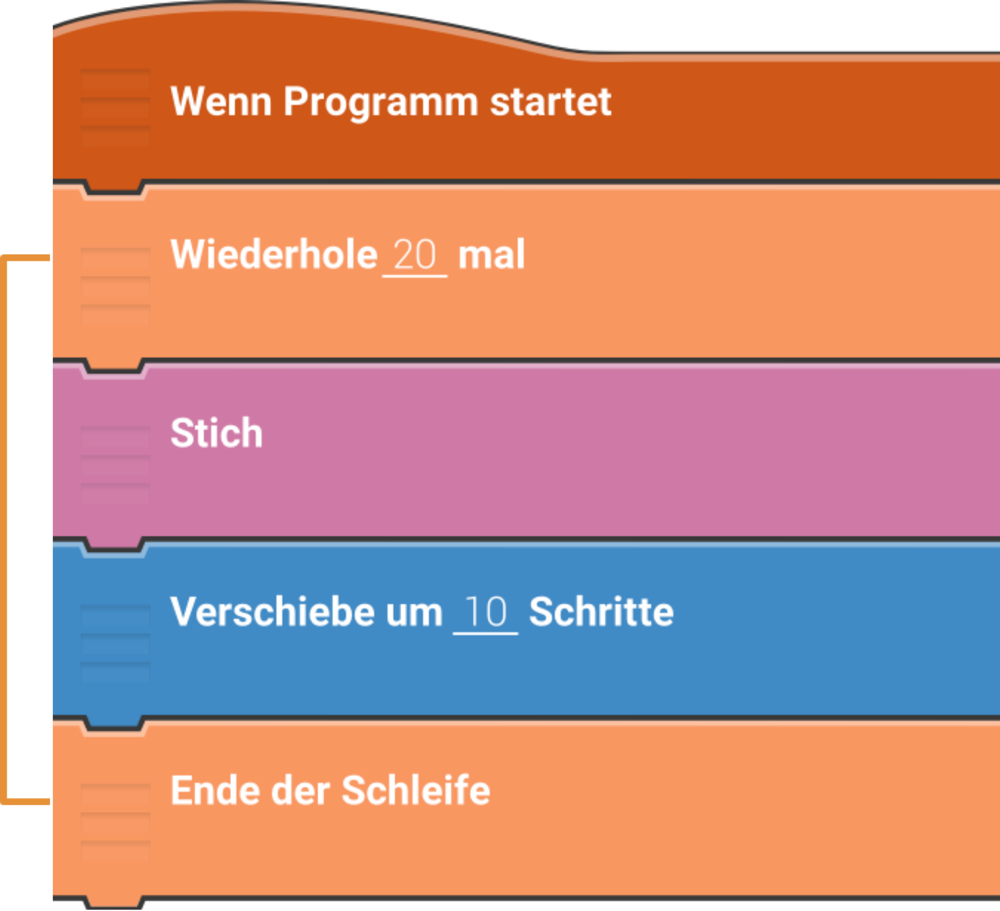

Lässt die Stickmaschine einmal in den Stoff sticken.

Folgendes Skript sticht in den Stoff und verschiebt dann den Nadelkopf um 10 Schritte.

Dies wird 20 mal wiederholt.

Damit erzeugst du eine Naht:

