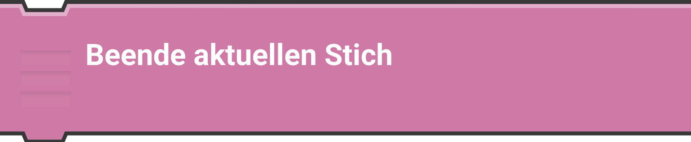
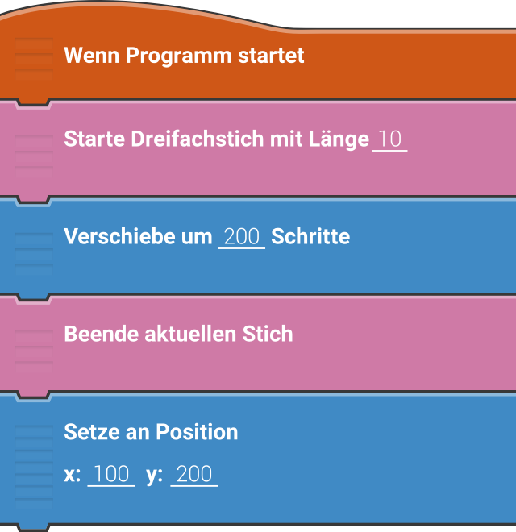

Stoppt den aktuellen Lauf-, Zickzack- oder Dreifachstich.

Diesen Baustein braucht man, wenn man nach einem Lauf-, Zickzack- oder Dreifachstich die Position der Stickmaschine ändern will.

Ohne den Beende-Baustein würde es eine unerwünschte Zwischennaht geben.

