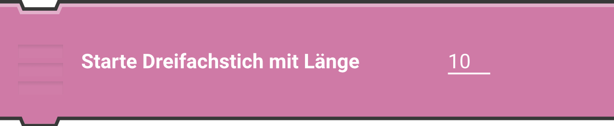
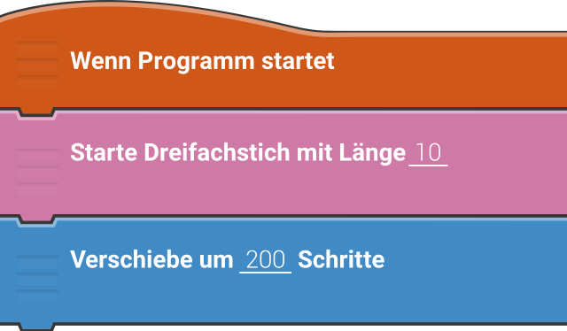

Vernäht jeden Stich dreimal.

Der Dreifachstich springt nach dem ersten Stich zurück, sticht, springt nach vorne und sticht erneut.

Funktioniert wie der [Laufstich](running-stitch.md).

Das macht die Naht besser haltbar.

