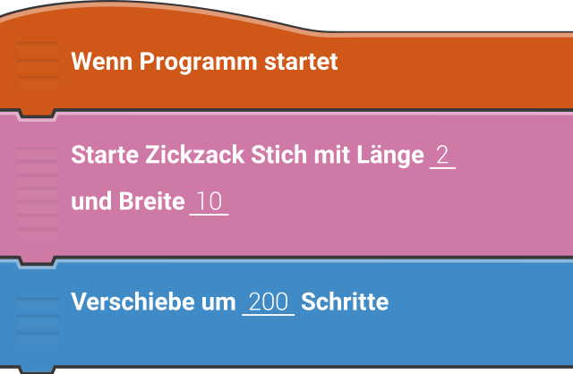

Lässt mit einer variablen Länge und Breite im Zickzack sticken.

Probiere am Besten verschiedene Werte für die Länge und die Breite aus. So kannst du den Baustein kennenlernen!

Mit dem Zickzack-Stich kannst du dickere Nähte sticken.

