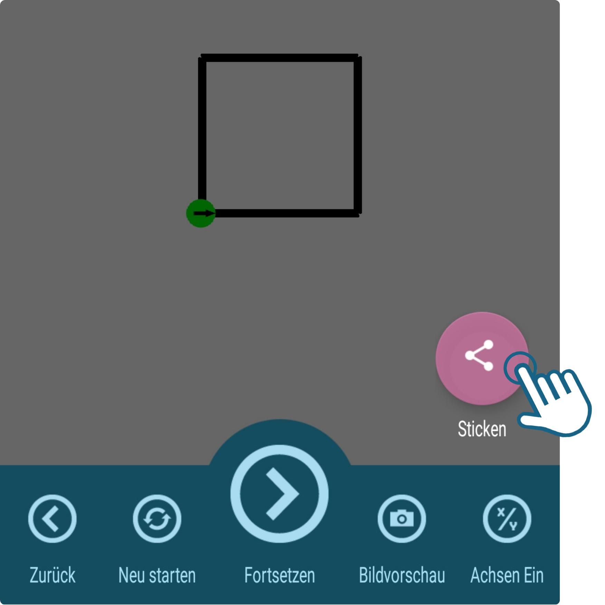
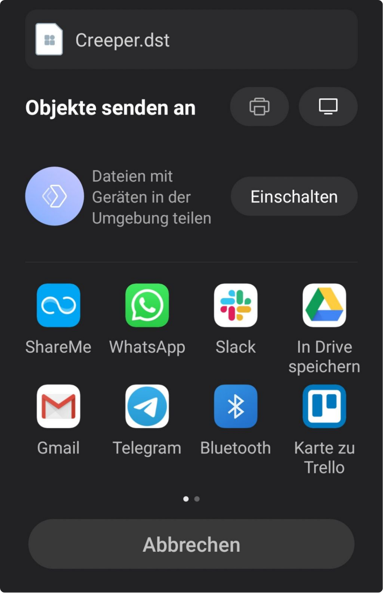

In diesem Tutorial erfährst du wie du deine fertigen Designs auf deinem Handy speichern und teilen kannst.

Dafür brauchst du ein fertiges Stickdesign, dass du exportieren möchtest. Hast du noch keins, kannst du dich gerne von unseren [Sticktutorials](index.md) inspirieren lassen!

*Hier kannst du das Tutorial im PDF-Format herunterladen:*

[Designs exportieren](../../../media/embroidery-tutorials/Designs-exportieren.pdf)

### 1. Starte dein Projekt und warte bis das Design vollständig gezeichnet ist. Ansonsten wird das Muster nicht richtig gestickt.

### 2. Gehe zurück und tippe auf den teilen-Button

### 3. Teile dein Stick-File per E-Mail oder speichere es am Handy.

Die Teilen-Funktion kann auf jedem Handy ein bisschen anders aussehen.

Dein Stick-Design wird als DST-Datei gespeichert.

Die Stickmaschine erkennt dieses Dateiformat und stickt dein Design auf deinen Stoff.
