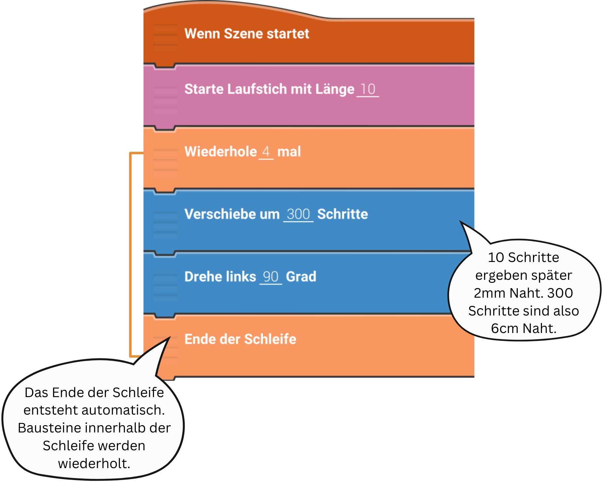

In diesem Tutorial erfährst du, wie du ein Viereck (60 x 60mm) sticken kannst.

Du solltest dafür schon wissen, wie man ein neues Objekt erstellt und dort Bausteine einfügt. Sieh dir gerne die Tutorials der [Starter-Reihe](../../game-tutorials/starter-tutorials/index.md) an, wenn du da noch Hilfe benötigst. Außerdem müssen die Stickbausteine schon aktiviert sein. Wie das geht erfährst du im Tutorial **[Stickbausteine aktivieren](activate-embroidery-bricks.md)**.

Für mehr Informationen oder Designvorschläge schau dir doch auch die anderen Tutorials an.

*Hier kannst du das Tutorial im PDF-Format herunterladen:*

[Viereck](../../../media/embroidery-tutorials/Viereck.pdf)

### 1. Erstelle zuerst ein neues Stick-Objekt (siehe Tutorial [Stickobjekte erstellen](create-embroidery-objects.md)).

### 2. Füge jetzt Schritt für Schritt die Bausteine zu deinem Skript hinzu:

Ein Viereck besteht aus vier Linien, welche jeweils in einem Winkel von 90 Grad zueinander stehen. Daher startet das Skript zuerst den Laufstich. Dann verschiebt man die Nadel um 300 Schritte und dreht sich 90 Grad. Das wird viermal wiederholt.

Was passiert wenn du die Grad oder die Schritte veränderst?

**Probiere es aus!**

### 3. Drücke auf den Play-Button um zu starten.
