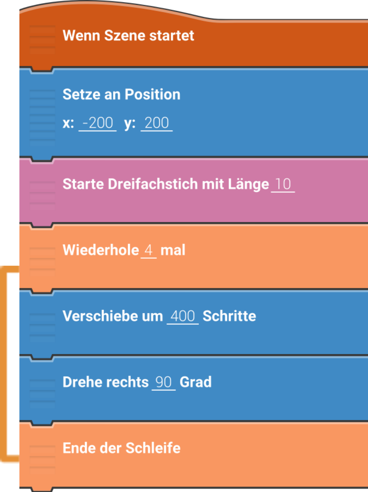

In diesem Tutorial erfährst du, wie du das Gesicht vom Creeper aus Minecraft (80 x 80mm) sticken kannst.

Du solltest dafür schon wissen, was eine Schleife ist und wie sie funktioniert.

Das Tutorial **[Viereck](../embroidery-tutorials-beginner/square.md)** könnte für dieses Tutorial hilfreich sein.

Sieh dir gerne die Stick-Tutorials der [Beginner](../embroidery-tutorials-beginner/index.md)-Reihe an, wenn du noch gar nichts gestickt hast.

Für mehr Informationen oder Designvorschläge schau dir doch auch die anderen Tutorials an.

*Hier kannst du das Tutorial im PDF-Format herunterladen:*

[Creeper-Minecraft](../../../media/embroidery-tutorials/Creeper-Minecraft.pdf)

### 1. Erstelle zuerst ein neues Stick-Objekt (siehe Tutorial [Stickobjekte erstellen](../embroidery-tutorials-beginner/create-embroidery-objects.md)) und erstelle darin folgende Skripte:

### 2. Gesicht

### 3. Umrandung

### 4. Drücke auf den Play-Button um zu starten.
