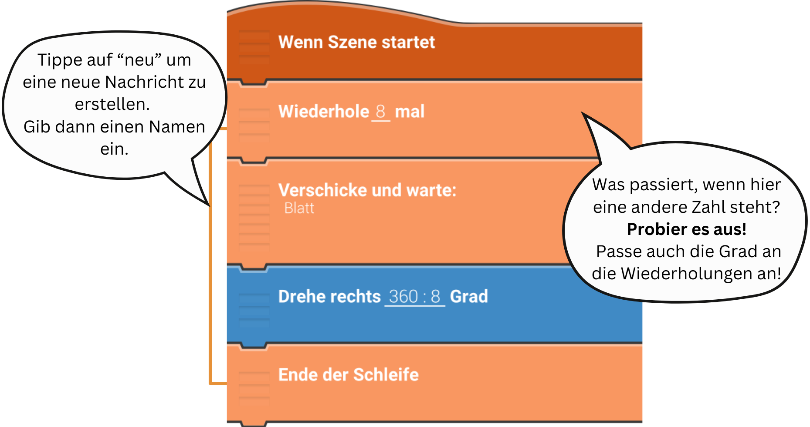
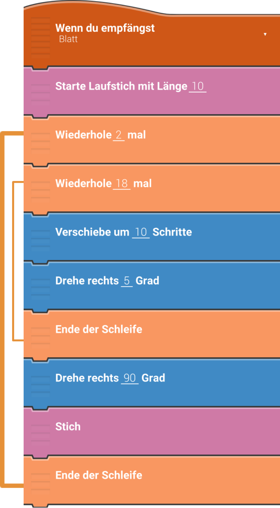

In diesem Tutorial erfährst du, wie du einen Lotus (64,8 x 64,8mm) sticken kannst.

Du solltest dafür schon wissen, was eine Schleife ist und wie sie funktioniert.

Sieh dir gerne die Stick-Tutorials der [Beginner](../embroidery-tutorials-beginner/index.md)-Reihe an, wenn du noch gar nichts gestickt hast.

Für mehr Informationen oder Designvorschläge schau dir doch auch die anderen Tutorials an.

*Hier kannst du das Tutorial im PDF-Format herunterladen:*

[Lotus-de](../../../media/embroidery-tutorials/Lotus-de.pdf)

### 1. Erstelle zuerst ein neues Stick-Objekt (siehe Tutorial [Stickobjekte erstellen](../embroidery-tutorials-beginner/create-embroidery-objects.md)) und erstelle darin folgende Skripte:

### 2. Grundgerüst

### 3. Blütenblätter

Dieser Teil wird jedesmal aufgerufen, wenn die Nachricht Blatt verschickt wird. Füge ihn zu deinem Skript hinzu.

### 4. Drücke auf den Play-Button um zu starten.
