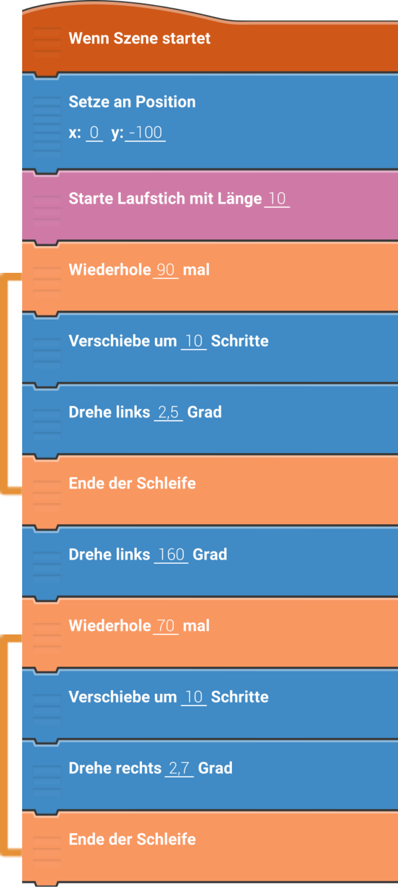
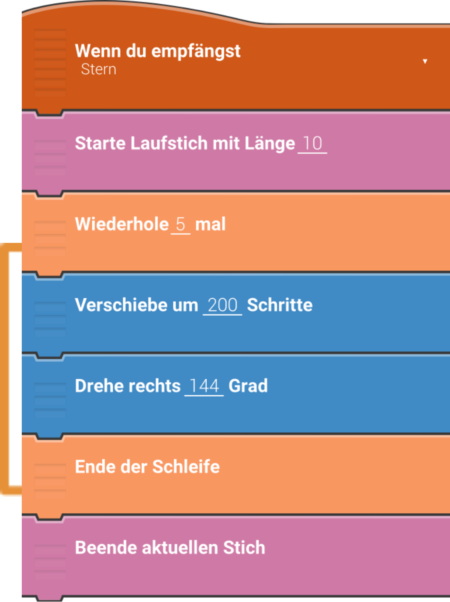
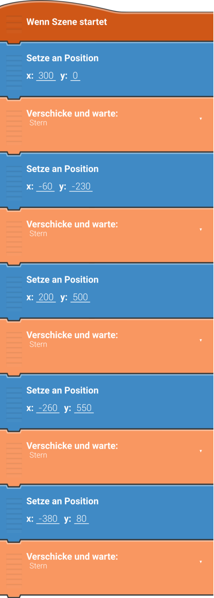

In diesem Tutorial erfährst du, wie du einen Nachthimmel (48,5 x 96,1mm) sticken kannst.

Du solltest dafür schon wissen, was eine Schleife ist und wie sie funktioniert.

Das Tutorial **[Stern](../embroidery-tutorials-beginner/star.md)** könnte für dieses Tutorial hilfreich sein.

Außerdem ist es hilfreich, wenn du dich bereits mit der Nachrichtenfunktion auskennst.

Sieh dir gerne die Stick-Tutorials der [Beginner](../embroidery-tutorials-beginner/index.md)-Reihe an, wenn du noch gar nichts gestickt hast.

Für mehr Informationen oder Designvorschläge schau dir doch auch die anderen Tutorials an.

*Hier kannst du das Tutorial im PDF-Format herunterladen:*

[Nachthimmel](../../../media/embroidery-tutorials/Nachthimmel.pdf)

### 1. Erstelle zuerst ein neues Stick-Objekt (siehe Tutorial [Stickobjekte erstellen](../embroidery-tutorials-beginner/create-embroidery-objects.md)) und erstelle darin folgende Skripte:

### 2. Mond

### 3. Ein Stern

Dieser Teil wird jedesmal aufgerufen, wenn die Nachricht Stern verschickt wird. Füge ihn zu deinem Skript hinzu.

### 4. Alle Sterne

### 5. Drücke auf den Play-Button um zu starten.
