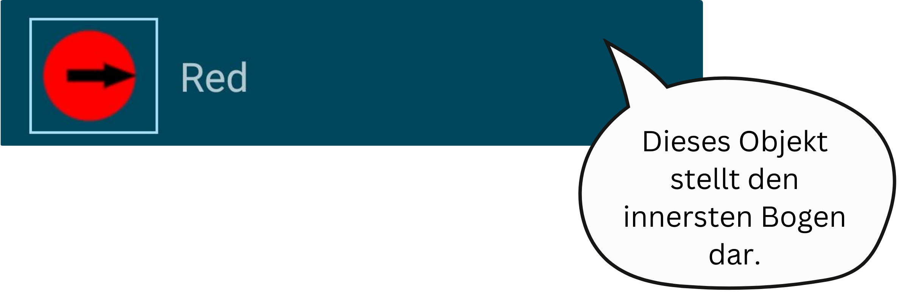
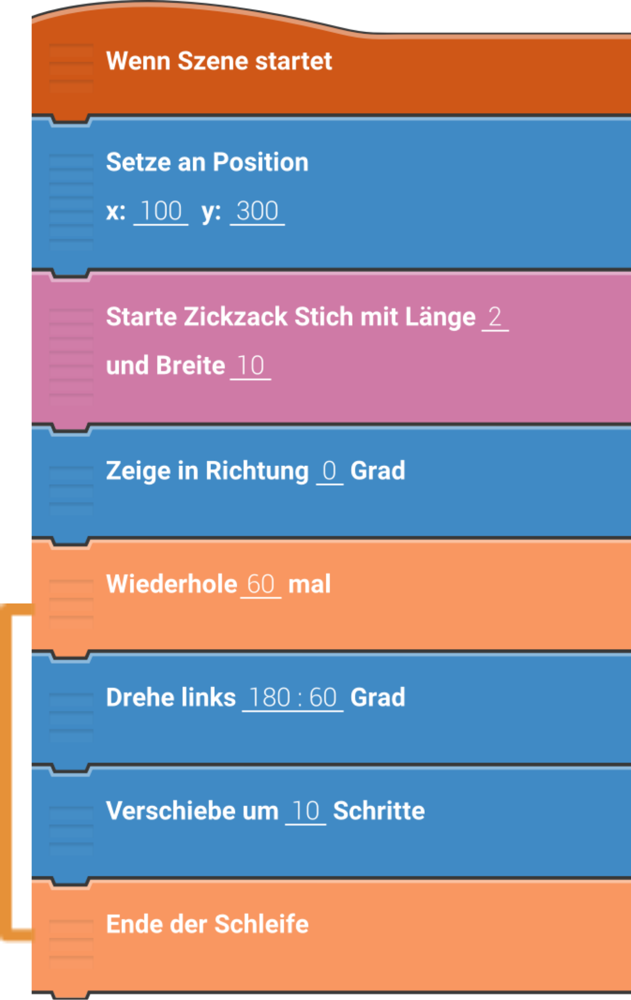
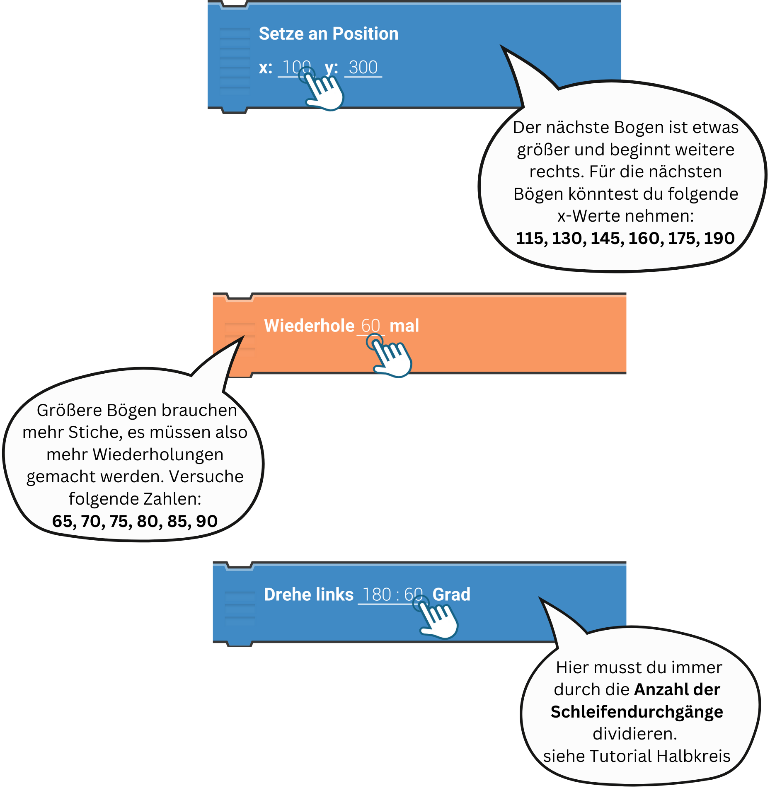

In diesem Tutorial erfährst du, wie du einen Regenbogen (112 x 57,2mm) sticken kannst.

Du solltest dafür schon wissen, was eine Schleife ist und wie sie funktioniert.

Das Tutorial **[Halbkreis](../embroidery-tutorials-beginner/semicircle.md)** könnte für dieses Tutorial hilfreich sein.

Sieh dir gerne die Stick-Tutorials der [Beginner](../embroidery-tutorials-beginner/index.md)-Reihe an, wenn du noch gar nichts gestickt hast.

Für mehr Informationen oder Designvorschläge schau dir doch auch die anderen Tutorials an.

*Hier kannst du das Tutorial im PDF-Format herunterladen:*

[Regenbogen](../../../media/embroidery-tutorials/Regenbogen.pdf)

### 1. Erstelle zuerst ein neues Stick-Objekt (siehe Tutorial [Stickobjekte erstellen](../embroidery-tutorials-beginner/create-embroidery-objects.md)):

### 2. Erstelle darin nun folgendes Skript:

### 3. Objekt kopieren

Für den nächst größeren Bogen kannst du einfach das soeben erstellte Objekt kopieren.

Klicke in der Objekte-Übersicht rechts oben auf die drei Punkte.

Gehe dann auf “Kopieren” und wähle das Objekt aus.

Wenn du für jeden Bogen ein eigenes Objekt verwendest, kannst du sie später in unterschiedlichen Farben sticken.

### 4. Objekt anpassen

Damit die Bögen nun auch unterschiedlich groß sind, müssen wir noch ein paar Werte ändern.

Gehe dazu in das Skript des kopierten Objekts und passe folgende Werte an:

### 5. Wiederhole Schritt 3 und 4 für weitere Bögen!

### 6. Drücke auf den Play-Button um zu starten.
