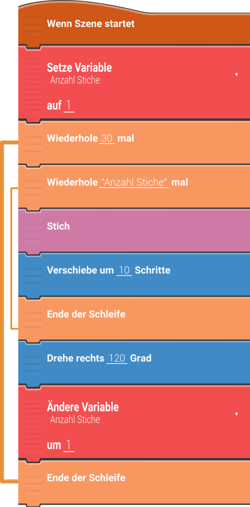
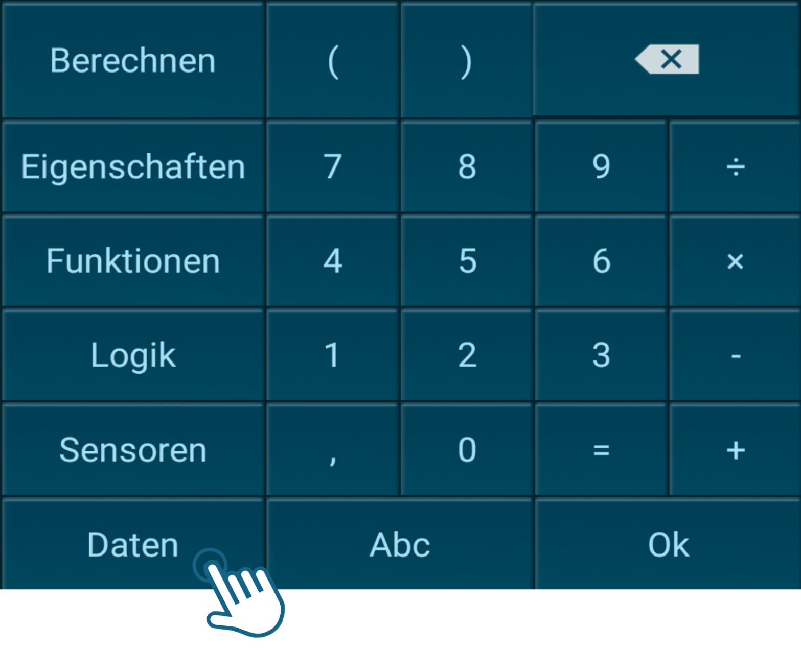

In diesem Tutorial erfährst du, wie du eine Dreieck Spirale (50,2 x 58mm) sticken kannst.

Du solltest dafür schon wissen, was eine Schleife ist und wie sie funktioniert.

Sieh dir gerne die Stick-Tutorials der [Beginner](../embroidery-tutorials-beginner/index.md)-Reihe an, wenn du noch gar nichts gestickt hast.

Für mehr Informationen oder Designvorschläge schau dir doch auch die anderen Tutorials an.

*Hier kannst du das Tutorial im PDF-Format herunterladen:*

[Dreieck Spirale](../../../media/embroidery-tutorials/Dreieck-Spirale.pdf)

### 1. Erstelle zuerst ein neues Stick-Objekt (siehe Tutorial [Stickobjekte erstellen](../embroidery-tutorials-beginner/create-embroidery-objects.md)) und erstelle darin folgendes Skript:

### 2. Drücke auf den Play-Button um zu starten.

Drücke auf “Neu” um eine neue Variable zu erstellen.

Du findest die Variable “Grad” dann im Formeleditor unter Daten.

