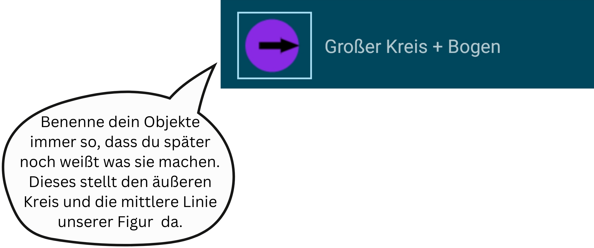
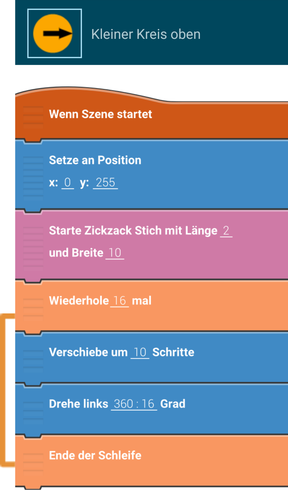
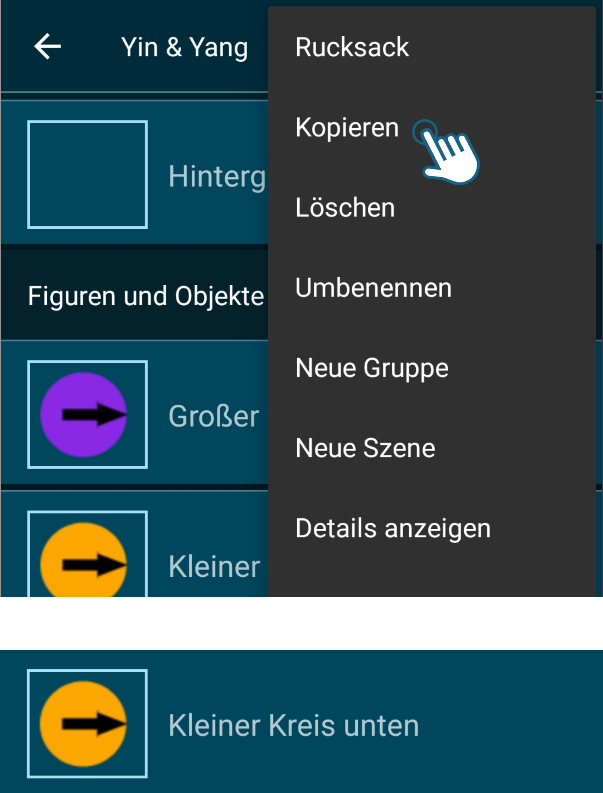
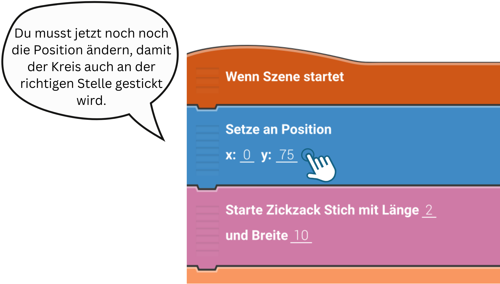

In diesem Tutorial erfährst du, wie du Yin und Yang (78,4 x 78,4mm) sticken kannst.

Du solltest dafür schon wissen, was eine Schleife ist und wie sie funktioniert.

Das Tutorial **[Kreis](../embroidery-tutorials-beginner/circle.md)** könnte für dieses Tutorial hilfreich sein.

Sieh dir gerne die Stick-Tutorials der [Beginner](../embroidery-tutorials-beginner/index.md)-Reihe an, wenn du noch gar nichts gestickt hast.

Für mehr Informationen oder Designvorschläge schau dir doch auch die anderen Tutorials an.

*Hier kannst du das Tutorial im PDF-Format herunterladen:*

[Yin und Yang](../../../media/embroidery-tutorials/Yin-und-Yang.pdf)

### 1. Erstelle zuerst ein neues Stick-Objekt (siehe Tutorial [Stickobjekte erstellen](../embroidery-tutorials-beginner/create-embroidery-objects.md)):

### 2. Erstelle darin nun folgendes Skript für den großen Kreis:

### 3. Mittlerer Bogen

Füge auch diesen Teil zu deinem Skript hinzu:

### 4. Kleiner Kreis oben

Erstelle ein neues Stick-Objekt und erstelle darin folgendes Skript:

### 5. Kleinen Kreis kopieren

Dafür kannst du das Objekt von Schritt 4 einfach kopieren:

### 6. Kleiner Kreis unten

Jetzt musst du noch die Position des unteren Kreises ändern:

### 7. Drücke auf den Play-Button um zu starten.
