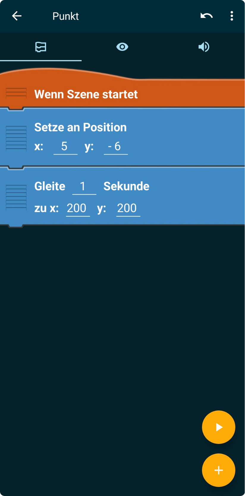
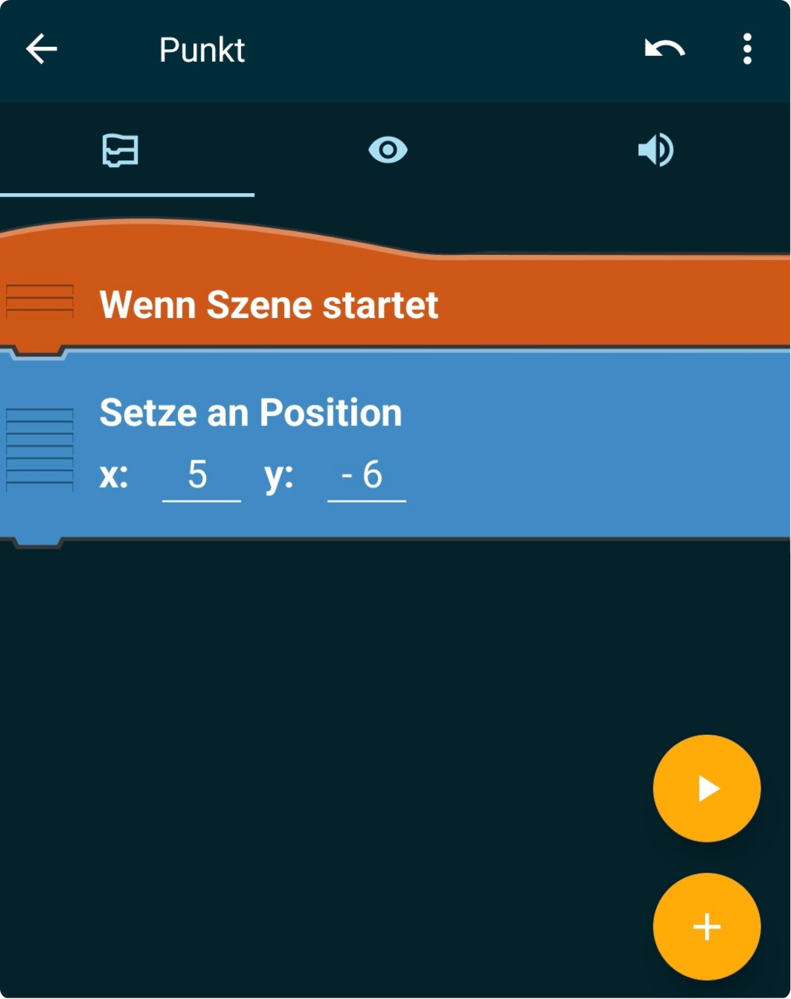
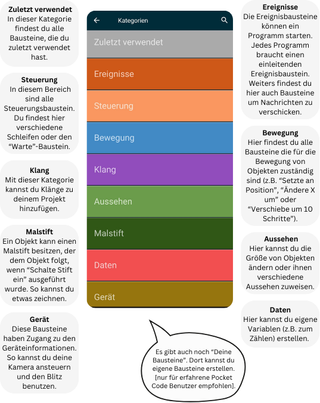
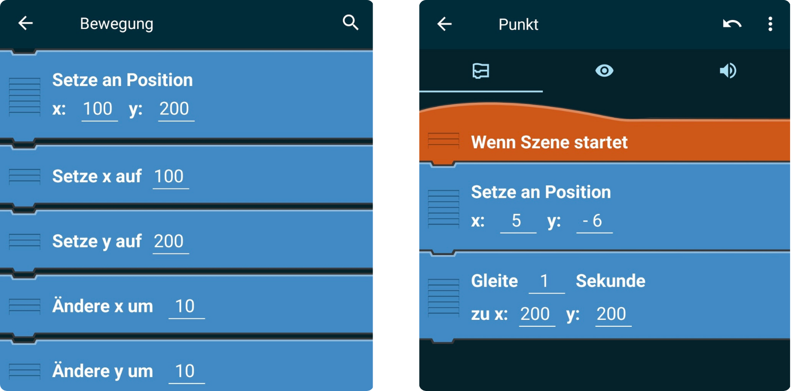

In diesem Tutorial erfährst du, wo du die verschiedensten Bausteine findest, um ein Objekt zu programmieren. Außerdem gibt dir dieses Tutorial einen guten Überblick über die Baustein-Kategorien.

\
Außerdem gibt dir dieses Tutorial einen guten Überblick über die Baustein-Kategorien.\
[Bild öffnen](../../../media/game-tutorials/Erste-Bausteine.png)

Damit du Bausteine einfügen und dein Objekt programmieren kannst, solltest du bereits ein Projekt mit einem Objekt erstellt haben. Falls du dabei noch Hilfe benötigst, kannst du dir das Tutorial **[Neues Objekt](new-object.md)** anschauen.

*Hier kannst du das Tutorial im PDF-Format herunterladen:*

[PDF öffnen](../../../media/game-tutorials/Erste-Bausteine.pdf)

### 1. Öffne existierendes Objekt

Zuerst musst du dein Projekt öffnen. Du solltest bereits ein Objekt erstellt haben (falls nicht, schau dir das Tutorial **[Neues Objekt](new-object.md)** an). Jetzt kannst du auf den Namen des Objekts klicken.

### 2. Vorhandene Bausteine

Danach wirst du sehen, dass bereits einige Bausteine vorhanden sind. Diese Bausteine wurden erstellt, als wir das Objekt visuell platziert haben. Diese Bausteine tun nichts weiter, als unser Objekt an genau der Position zu platzieren, die wir am Anfang ausgewählt haben, sobald du das Projekt startest.

\
Du kannst diese Position auch jederzeit hier ändern.\
[Bild öffnen](../../../media/game-tutorials/Erste-Bausteine-1.png)

### 3. Bausteine einfügen

Jetzt kannst du weitere Bausteine erstellen, indem du auf den gelben Plus-Button in der unteren rechten Ecke klickst. Du wirst ein neues Fenster sehen, das dir verschiedene Kategorien für Bausteine anzeigt. Diese Kategorien werden im nächsten Schritt beschrieben.

### 4. Baustein Kategorien

\
Das sind die verschiedenen Baustein Kategorien.\
[Bild öffnen](../../../media/game-tutorials/Erste-Bausteine-2.png)

### 5. Ersten Baustein einfügen

Für unsere ersten Bausteine möchten wir den Baustein “Gleite 1 Sekunde zu X: Y:” verwenden. Du findest ihn in der Kategorie “Bewegung”. Mit dem Formeleditor kannst du die Anzahl der Sekunden sowie die Position X und Y bearbeiten.

### 6. Baustein platzieren

Platziere den Baustein an der letzten Stelle deines Programms und führe dein Programm zum ersten Mal aus.

\
Das kannst du mit dem gelben Play-Button tun.\
[Bild öffnen](../../../media/game-tutorials/Erste-Bausteine-3.png)

### 7. Du hast es geschafft! Du hast deinen ersten Baustein eingefügt.

Nun hast du dein erstes Objekt programmiert!

Wenn du dein Projekt mit deinen Freunden teilen möchtest, kannst du das Tutorial **[Hochladen und Teilen](upload-and-share.md)** ausprobieren, wo genau erklärt wird, wie es funktioniert. Andernfalls kannst du bereits mit deinem ersten eigenen Projekt beginnen. Wenn du Hilfe oder Inspiration benötigst, schau dir gerne unsere Tutorials aus der Beginner-Serie an.

[Hier](../../../reference/) findest du weitere Informationen zu allen Bausteinen!
