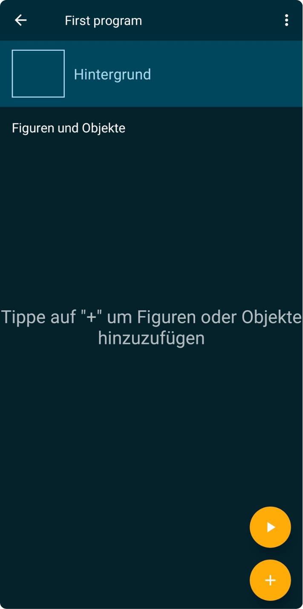
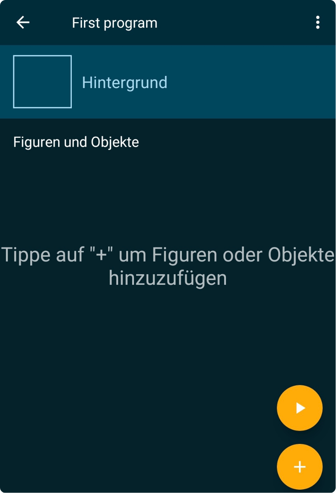
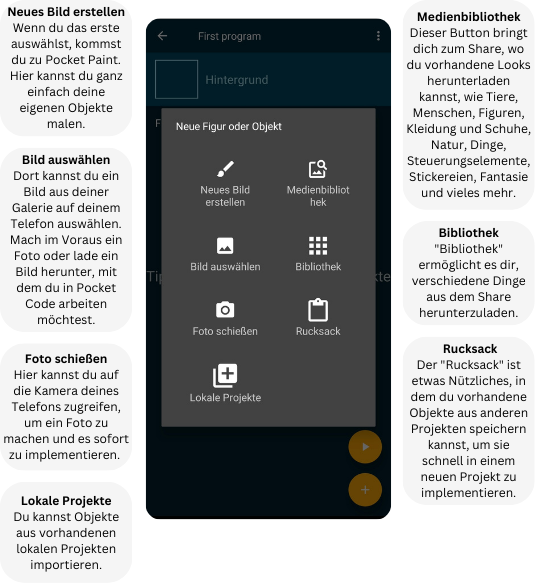
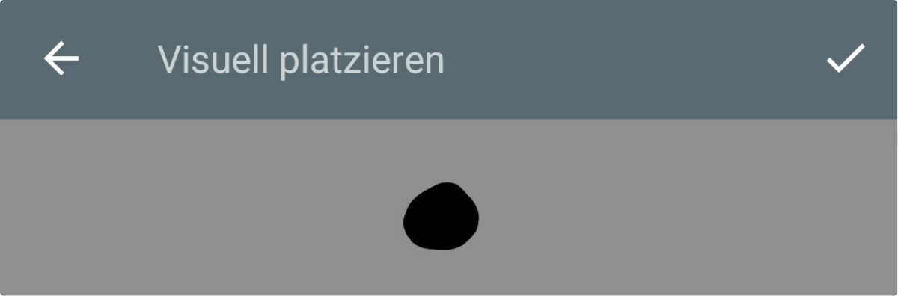

In diesem Tutorial erfährst du, wie du ein neues Objekt in deinem Projekt erstellst und welche verschiedenen Möglichkeiten dir dabei zur Verfügung stehen.

Um dies umzusetzen, solltest du bereits die Pocket Code App heruntergeladen haben und wissen, wie man ein neues Projekt erstellt. Falls du dabei noch Hilfe benötigst, kannst du dir das Tutorial **[Neues Projekt](new-project.md)** anschauen.

*Hier kannst du das Tutorial im PDF-Format herunterladen:*

[Neues Objekt](../../../media/game-tutorials/Neues-Objekt.pdf)

### 1. Neues Objekt erstellen

Zuerst musst du dein neues Projekt öffnen.

Du findest es auf dem Startbildschirm der Pocket Code App. Wenn du mehr als ein Projekt hast, kannst du auf “Projekte auf dem Gerät” klicken. Wähle dann dein neues Projekt aus. Wenn du noch kein neues Projekt erstellt hast oder weitere Informationen dazu benötigst, schau dir das Tutorial **[Neues Projekt](new-project.md)** an.

### 2. Neues Objekt erstellen

Nun bist du bereit, ein neues Objekt zu erstellen. Klicke dazu einfach auf den gelben Plus-Button unten rechts. Es öffnet sich ein neues Fenster, das dir sieben Möglichkeiten zur Auswahl bietet.

### 3. Auswahlmöglichkeiten

Das sind die Möglichkeiten aus denen du wählen kannst:

### 4. Bild zeichnen

Um es am Anfang so einfach wie möglich zu gestalten, verwenden wir die Funktion “Bild zeichnen” und zeichnen einfach einen Punkt. Wenn du den Punkt mit Pocket Paint gezeichnet hast, kannst du es verlassen, indem du einen Schritt zurück gehst.

### 5. Namen geben

Nun musst du deinem Bild einen Namen geben.

### 6. Platzieren

Danach musst du es visuell platzieren, indem du es mit deinem Finger nach links/rechts oder oben/unten verschiebst. Du musst es mit dem Button in der oberen rechten Ecke speichern.

::brick{type=PlaceAtBrick}

### 7. Du hast es geschafft! Du hast ein eigenes neues Objekt erstellt.

Nun hast du ein Projekt mit einem Objekt, welches du programmieren kannst!

Um das zu machen, solltest du wissen welche Bausteine es gibt. Das Tutorial **[Erste Bausteine](first-bricks.md)** gibt dir einen guten Überblick über die verschiedenen Baustein-Kategorien. Du kannst aber auch direkt mit einem ersten Projekt starten. Such dir dazu ein passendes Tutorial aus der Beginner-Serie aus.
