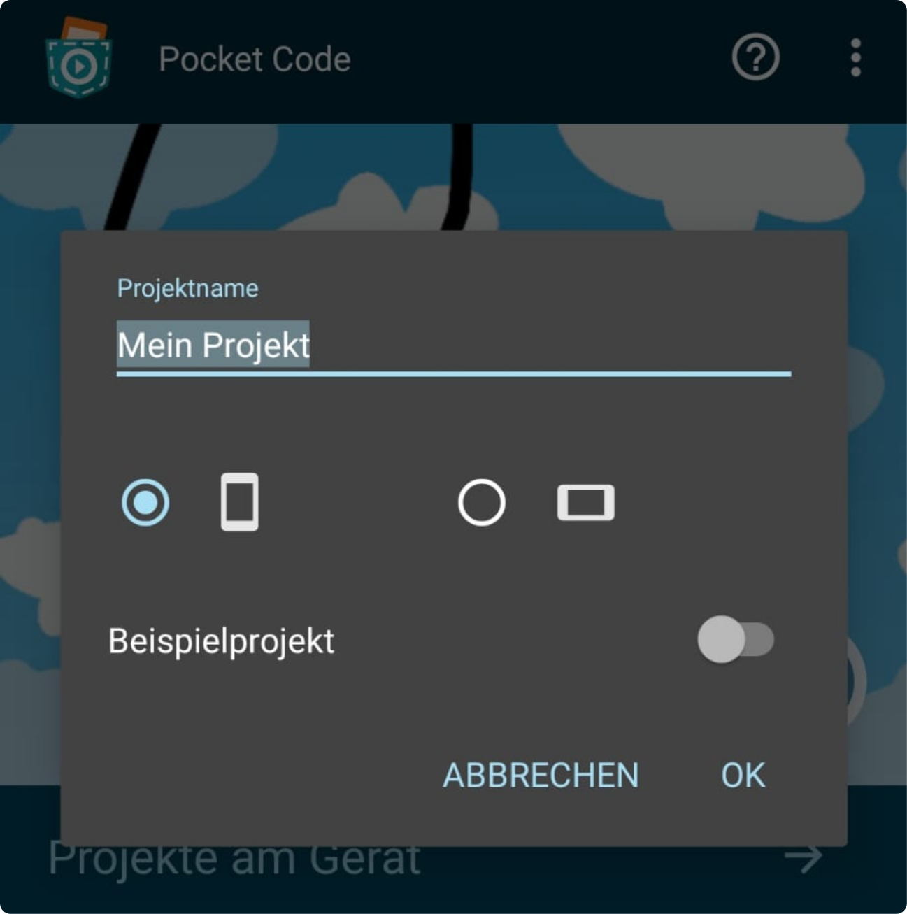
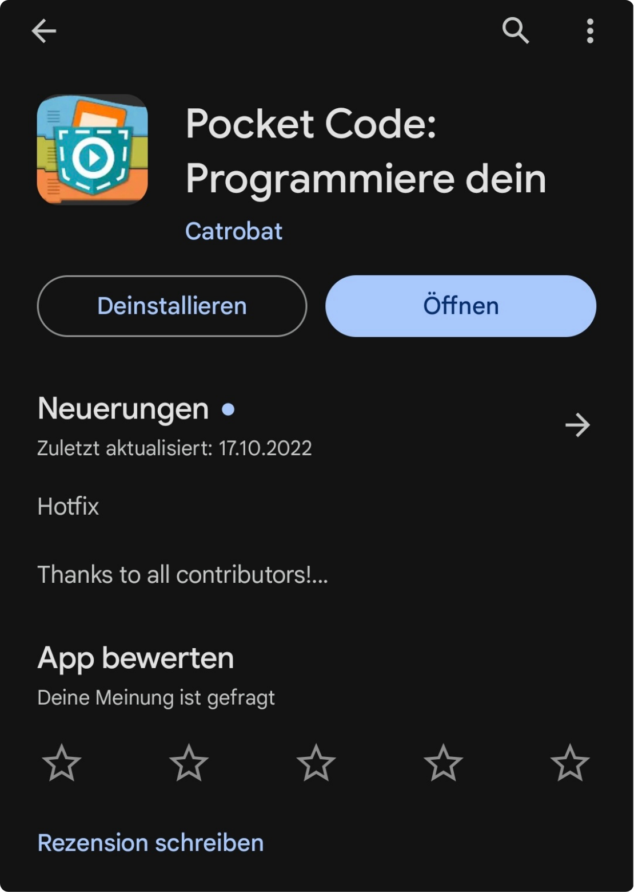
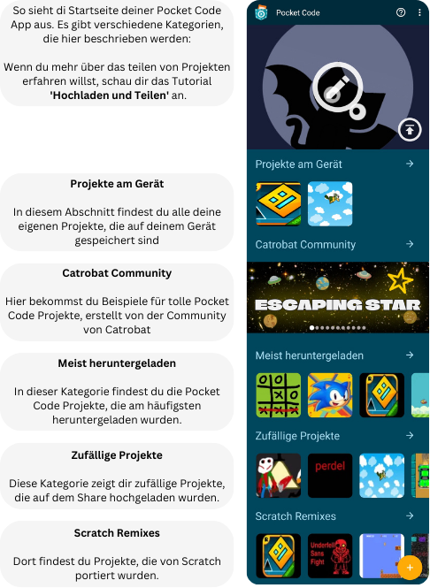

In diesem Tutorial erfährst du alles, was du über Pocket Code wissen musst, um mit deinem ersten Projekt zu starten. Wir zeigen dir Schritt für Schritt, wie du die App herunterlädst, öffnest und ein neues Projekt erstellst.

Dies ist das allererste Tutorial und du benötigst keinerlei Vorkenntnisse.

Also, worauf wartest du noch? Hol dein Handy raus und leg gleich los!

*Hier kannst du das Tutorial im PDF-Format herunterladen:*

[Neues Projekt](../../../media/game-tutorials/Neues-Projekt.pdf)

### 1. Installation von Pocket Code

Zuerst musst du die Pocket Code App auf deinem Gerät installieren. Du findest die App, indem du im Google Play Store nach “Pocket Code” suchst und auf “Installieren” klickst. Für diesen Schritt ist ein Google-Konto erforderlich. Dein Gerät wird jetzt die App herunterladen und installieren. Dieser Schritt kann je nach Internetverbindung einige Zeit in Anspruch nehmen.

Nachdem du Pocket Code erfolgreich heruntergeladen und installiert hast, findest du die App im App-Drawer oder auf deinem Startbildschirm, je nachdem, welches Gerät du verwendest. Du kannst die App ganz einfach nehmen und sie an die Stelle deiner Wahl platzieren.

### 2. Starten der App

Wenn du die App öffnest, siehst du verschiedene Kategorien:

### 3. Neues Projekt erstellen

Der nächste Schritt ist tatsächlich ein neues Projekt zu erstellen. Dazu kannst du auf den gelben Plus-Button in der unteren rechten Ecke drücken. Jetzt musst du einen Projektnamen eingeben und auswählen, ob dein Projekt im Querformat sein soll oder nicht. Durch Drücken von “OK” wird das Projekt erstellt.

### 4. Du hast es geschafft! Du hast ein eigenes neues Projekt erstellt.

Jetzt hast du Pocket Code installiert und weißt, wie man ein neues Projekt erstellt. Nun kannst du auch schon mit dem Programmieren loslegen.

Dafür musst du wissen, wie man ein neues Objekt in einem Projekt erstellt. Schau dir dazu am besten das Tutorial **[Neues Objekt](new-object.md)** an, dort wird dir alles Schritt für Schritt erklärt.
