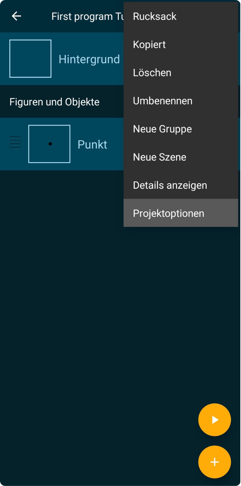
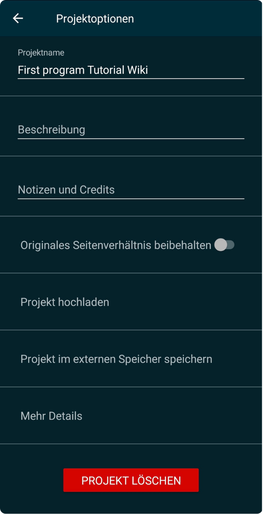
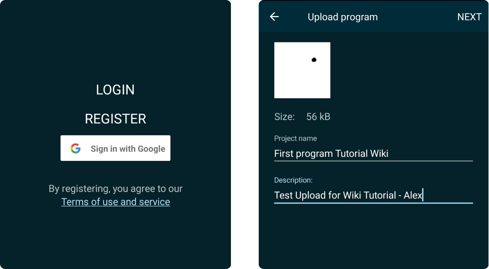
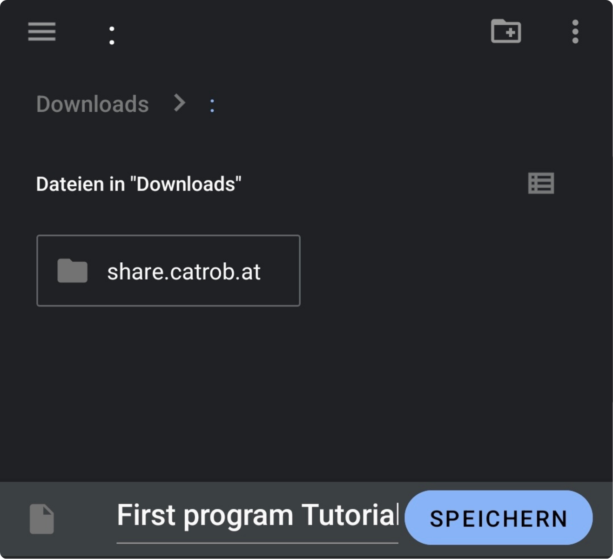

In diesem Tutorial erfährst du wie du deine erstellen Projekte mit deinen Freunden oder der gesamten Catrobat Community teilen kannst.

\
In diesem Tutorial erfährst du wie du deine erstellen Projekte mit deinen Freunden oder der gesamten Catrobat Community teilen kannst.\
[Bild öffnen](../../../media/game-tutorials/Hochladen-und-Teilen.png)

Für dieses Tutorial brauchst du bereits ein eigenes Projekt, welches tu teilen möchtest. Wenn du noch nicht weißt wie man ein Projekt erstellt, schau dir das Tutorial **[Neues Projekt](new-project.md)** an dort lernst du wie das funktioniert.

*Hier kannst du das Tutorial im PDF-Format herunterladen:*

[PDF öffnen](../../../media/game-tutorials/Hochladen-und-Teilen.pdf)

### 1. Projektoptionen

\
Wenn du dein Projekt hochladen oder teilen möchtest, musst du dein Projekt öffnen, dann auf die drei Punkte oben rechts klicken und anschließend “Projektoptionen” auswählen.\
[Bild öffnen](../../../media/game-tutorials/Hochladen-und-Teilen.png)

### 2. Projektoptionen

Jetzt kannst du den Namen ändern eine Beschreibung hinzufügen und verschiedene Einstellungen treffen.

\
Du hast auch zwei Optionen: “Projekt hochladen” und “Projekt im externen Speicher speichern” welche in den nächsten Schritten genauer erklärt werden.\
[Bild öffnen](../../../media/game-tutorials/Hochladen-und-Teilen-1.png)

### 3. Projekt hochladen

Wenn du dein Projekt auf Catrobat Share hochladen möchtest, damit die gesamte Community darauf zugreifen kann, wähle *Projekt hochladen*.

### 4. Projekt hochladen

Wenn du auf diese Schaltfläche klickst, um dein Projekt auf Share hochzuladen, musst du dich anmelden, falls du das noch nicht getan hast. Alternativ kannst du dich mit Google anmelden. Wenn du angemeldet bist, musst du deinem Projekt einen Namen geben und eine Beschreibung schreiben. Dann kannst du bis zu drei Kategorien auswählen, zu denen dein Programm am besten passt.

\
Klicke dann auf “Weiter”, um dein Programm hochzuladen.\
[Bild öffnen](../../../media/game-tutorials/Hochladen-und-Teilen-2.png)

### 5. Projekt im externen Speicher speichern

Wenn du dein Projekt mit deinen Freunden teilen möchtest, wähle *Projekt in externen Speicher speichern*.

### 6. Projekt im externen Speicher speichern

Mit dieser Option kannst du eine .catrobat-Datei speichern, die du privat mit deinen Freunden teilen kannst.

\
Du kannst sie im Datei-Explorer auf deinem Gerät speichern und auf diese Weise teilen.\
[Bild öffnen](../../../media/game-tutorials/Hochladen-und-Teilen-3.png)

Du hast es geschafft! Du hast dein erstes Programm geteilt!

Wenn du Hilfe oder Inspiration für kommende Projekte benötigst, schau dir gerne unsere Tutorials mit unterschiedlichen Schwierigkeitsgraden (Beginner/Medium/Pro) an.
