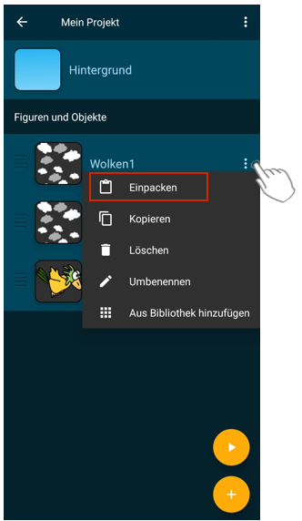
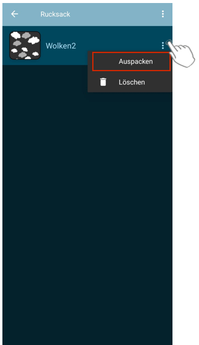
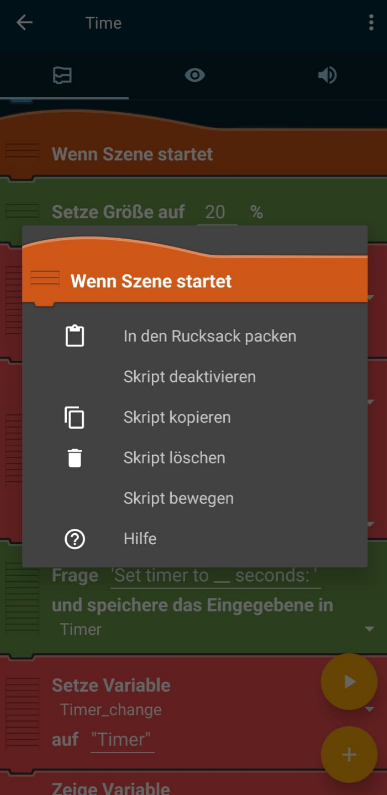
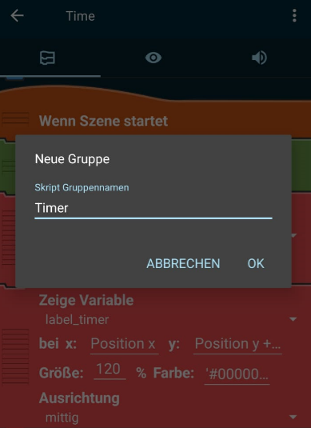
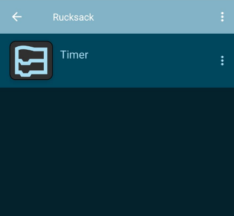
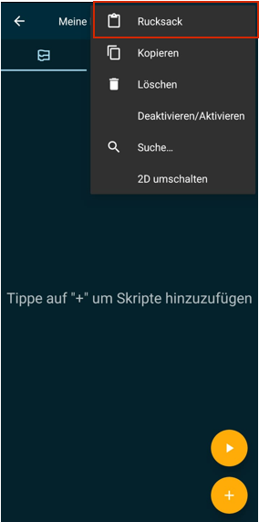
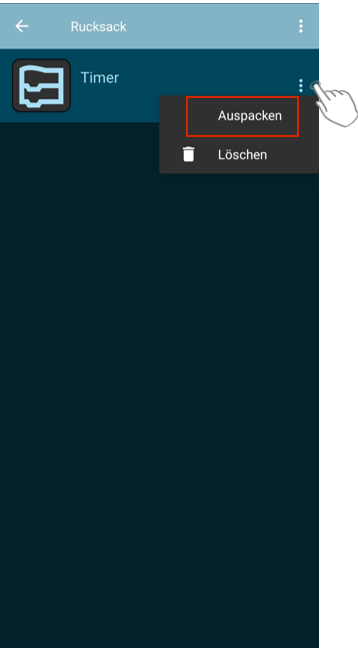

Der **Rucksack** in Pocket Code ist eine praktische Funktion, mit der du Elemente wie Figuren (Objekte), Skripte, Looks oder Sounds **projektübergreifend speichern und wiederverwenden** kannst. Er hilft dir, Arbeit zu sparen und Projekte effizienter zu gestalten.

Der Rucksack ist wie ein digitaler Speicherplatz, in dem du verschiedene Elemente aus deinem aktuellen Projekt ablegen kannst. Einmal im Rucksack gespeichert, kannst du diese Elemente in anderen Projekten abrufen und einfügen.

### Wie verwende ich den Rucksack für Figuren (Objekte)?

**Figuren in den Rucksack legen**

Gehe in die Projekt-Ansicht des Projektes, von dem du eine Figur in den Rucksack legen möchtest.

Klicke auf die drei Punkte neben der Figur, um das Kontextmenü zu öffnen und wähle “Einpacken”.

Die Figur (inklusive ihrer Looks, Sounds und Skripte) wird in den Rucksack gepackt.

**Figuren aus dem Rucksack hinzufügen**

Öffne das Projekt, in das du die Figur einfügen möchtest.

In der Projekt-Ansicht tippe auf das Plus-Symbol und wähle “Rucksack“.

Du siehst nun alle Figuren und Objekte, die du in deinem Rucksack gespeichert hast. Tippe auf die drei Punkte und wähle “auspacken”

***

### Wie verwende ich den Rucksack für Skripte?

**Skripte in den Rucksack legen:**

Gehe zur Figur, die das Skript enthält. Halte das gewünschte Skript im Skript-Editor gedrückt.

Wähle im Kontextmenü “In den Rucksack packen”.

Gib dem Skript einen Namen und bestätige mit OK.

Das Skript wird gespeichert und kann in anderen Projekten verwendet werden.

**Skripte aus dem Rucksack hinzufügen:**

Tippe auf die Figur, in die du das Skript einfügen möchtest. Du siehst den Skript Bereich. Tippe auf die drei Punkte, um das Kontextmenü zu öffnen und tippe auf “Rucksack”.

Du siehst nun alle Skripte, die sich bereits in deinem Rucksack befinden. Tippe bei dem gewünschten Skript auf die drei Punkte und wähle aus dem Kontextmenü “Auspacken”.

Über das Kontextmenü kannst du Skripte, die du nicht mehr in deinem Rucksack brauchst, löschen.

***

### Vorteile des Rucksacks

- **Projektübergreifende Wiederverwendbarkeit:** Figuren, Skripte, Sounds und Looks können einmal erstellt und beliebig oft wiederverwendet werden.
- **Zeitersparnis:** Du musst Figuren oder Skripte nicht jedes Mal neu erstellen.
- **Einheitlichkeit:** Elemente bleiben konsistent, wenn du sie in mehreren Projekten benötigst.
