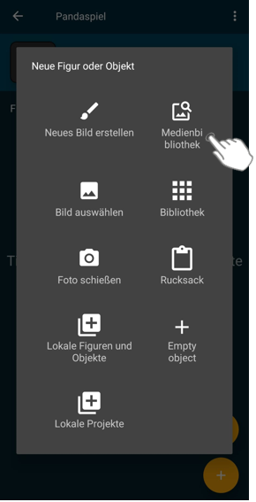
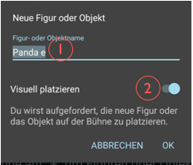
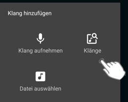
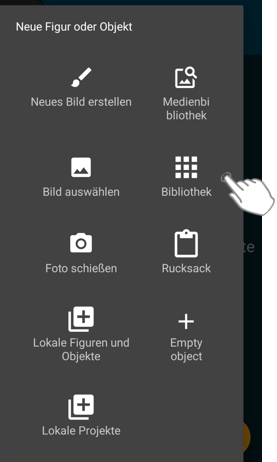
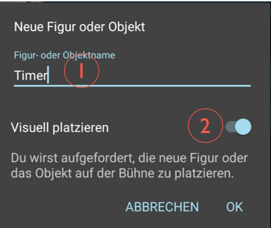

Die Medienbibliothek von Catrobat ist eine Sammlung von **Figuren**, **Hintergründen**, Sounds sowie Objekten, die du in deinen Projekten verwenden kannst. Du kannst alles anpassen, damit es zu deinen Ideen passt!

[Figur](#füge-eine-neue-figur-aus-der-medienbibliothek-hinzu)

[Hintergrund](#füge-einen-hintergrund-aus-der-medienbibliothek-hinzu)

[Sound](#füge-einen-sound-aus-der-medienbibliothek-hinzu)

[Objekt](#füge-ein-objekt-aus-der-medienbibliothek-hinzu)

***

### Füge eine neue Figur aus der Medienbibliothek hinzu

Tippe in der Projektansicht auf das + Symbol ([mehr Infos](../quick-start-guide/add-actors-and-objects.md)), um eine neue Figur oder ein neues Objekt hinzuzufügen.

\
Wähle “Medienbibliothek”.\
[Bild öffnen](../../../media/getting-started/grafik-18.png)

Suche dir eine Figur, die du in deinem Programm verwenden willst.

\
Tippe auf die Figur (1) und lade diese herunter (2).\
[Bild öffnen](../../../media/getting-started/grafik-19.png)

Du kannst nun der Figur einen neuen Namen geben (1) und sie visuell in deinem Spiel platzieren (2). Das bedeutet, dass du deine Figur direkt auf dem Bildschirm verschieben kannst. Dabei siehst du sofort, wo sie im Projekt steht.

\
Bestätige mit “OK”\
[Bild öffnen](../../../media/getting-started/grafik-20.png)

\
Platziere deine Figur (1) und bestätige mit dem Häkchen (2).\
[Bild öffnen](../../../media/getting-started/grafik-21.png)

***

### Füge einen Hintergrund aus der Medienbibliothek hinzu

Gehe in der Projektansicht zum Hintergrund. Wechsle in den Aussehen-Bereich und füge ein neues Aussehen hinzu ([mehr Infos](../quick-start-guide/add-background.md)). Tippe auf “Medienbibliothek”.

Suche dir einen passenden Hintergrund aus, den du in deinem Programm verwenden willst.

\
Tippe auf den Hintergrund (1) und lade diesen herunter (2).\
[Bild öffnen](../../../media/getting-started/grafik-22.png)

***

### Füge einen Sound aus der Medienbibliothek hinzu

Sounds können sowohl bei deinem Hintergrund als auch bei deinen Figuren und Objekten eingefügt werden. Tippe auf deine Figur oder den Hintergrund, bei dem du den Sound hinzufügen willst.

\
Gehe zur Sound-Ansicht und tippe auf das + Symbol.\
[Bild öffnen](../../../media/getting-started/grafik-23.png)

\
Tippe auf “Klänge”, um zur Medienbibliothek zu gelangen.\
[Bild öffnen](../../../media/getting-started/grafik-24.png)

Suche dir einen passenden Klang aus, den du in deinem Programm verwenden willst.

\
Tippe auf den Klang (1) und lade diesen herunter (2).\
[Bild öffnen](../../../media/getting-started/grafik-25.png)

***

### Füge ein Objekt aus der Medienbibliothek hinzu

Catrobat bietet dir die Möglichkeit, fertige Objekte herunterzuladen. Objekte sind einzelne Spielelemente wie beispielsweise ein Countdown, das bereits ein Skript enthält.

Du fügst Objekte ähnlich ein wie Figuren.

Tippe in der Projektansicht auf das + Symbol ([mehr Infos](../quick-start-guide/add-actors-and-objects.md)), um ein neues Objekt hinzuzufügen.

\
Wähle “Bibliothek”.\
[Bild öffnen](../../../media/getting-started/grafik-26.png)

Suche dir ein Objekt, das du in deinem Programm verwenden willst.

\
Tippe auf das Objekt (1) und lade es herunter (2).\
[Bild öffnen](../../../media/getting-started/grafik-27.png)

Du kannst nun dem Objekt einen neuen Namen geben (1) und es visuell in deinem Spiel platzieren (2). Das bedeutet, dass du dein Objekt direkt auf dem Bildschirm verschieben kannst. Dabei siehst du sofort, wo es im Projekt steht.

\
Bestätige mit “OK”\
[Bild öffnen](../../../media/getting-started/grafik-28.png)

Platziere deine Figur (1) und bestätige mit dem Häkchen (2).
