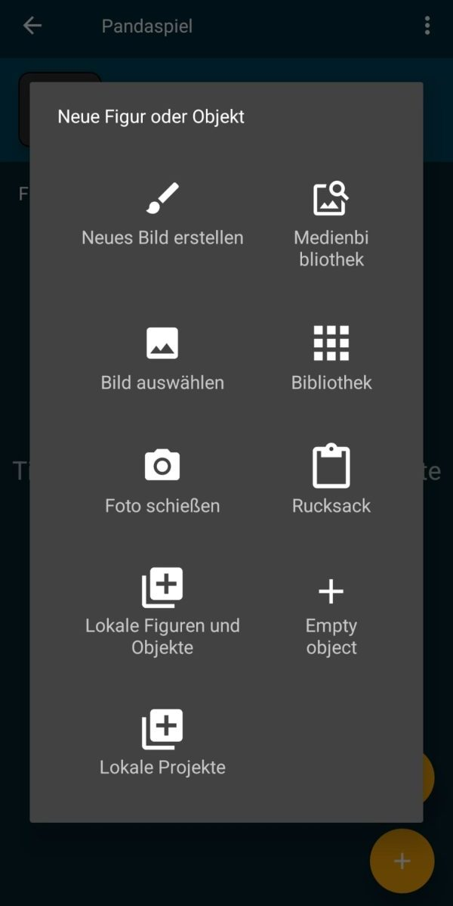

Tippe auf den Plus-Button, um eine neue Figur oder ein neues Objekt deinem Projekt hinzuzufügen.

In Pocket Code kannst du auf verschiedene Arten eine Figur oder ein Objekt zu deinem Projekt hinzufügen:

**Neues Bild erstellen**: Du kannst deine eigene Figur mit **Pocket Paint** erstellen. Pocket Paint ist ein Zeichenprogramm ([mehr zu Pocket Paint](https://catrobat.org/docs/pocket-paint/))

**Medienbibliothek**: Wähle aus einer Sammlung von vorgefertigten Figuren eine aus ([mehr zur Medienbibliothek)](../elements/medialibrary.md).

**Bild auswählen**: Du kannst ein Bild aus der Galerie deines Smartphones auswählen.

**Bibliothek**: In der Bibliothek findest du Figuren und Objekte, die bereits programmiert sind, also bereits ein Skript besitzen. Du kannst sie auswählen, wenn du bereits fertige Elemente in deinem Spiel verwenden willst (z.B. einen Countdown) ([mehr zur Bibliothek](../elements/medialibrary.md#Objekt-Medienbibliothek)).

**Foto schießen**: Du kannst die Kamera deines Geräts nutzen, um ein Foto zu machen, und dieses als Figur hinzufügen.

**Rucksack**: Der Rucksack ist aktuell noch leer. Du kannst Figuren oder Objekte, die du in deinem Rucksack gespeichert hast, wiederverwenden. Dabei wird das gesamte Skript mit ausgepackt ([mehr zum Rucksack](../elements/backpack.md))

**Lokale Figuren und Objekte**: Hier findest du fertige Figuren, die du in deinem Projekt verwenden kannst. Lokale Figuren und Objekte sind wie eine Offline-Medienbibliothek, d.h. auch wenn du gerade keine Internetverbindung hast, kannst du auf diese Figuren zugreifen.

**Empty Object**: Füge ein leeres Objekt ein, also ein Objekt, das kein Aussehen besitzt. Du kannst dieses Objekt ganz normal programmieren.

**Lokale Projekte**: Wähle ein Projekt aus, von dem du die erste Figur samt Skript in dein Projekt einfügst.

