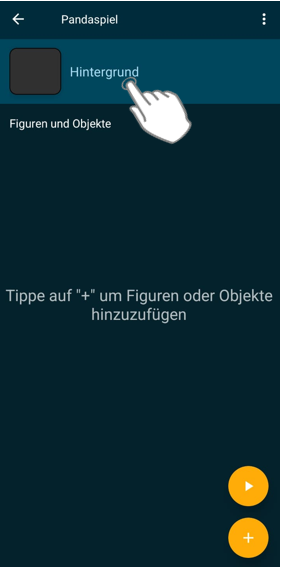
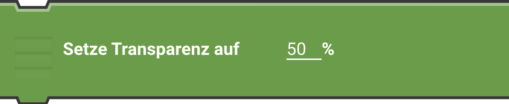
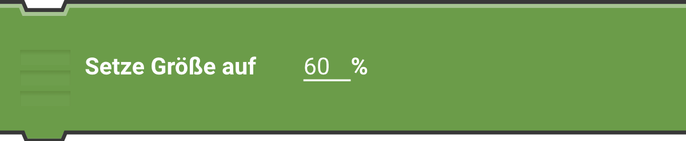
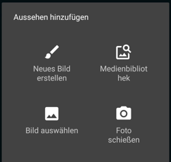

Du kannst deinem Projekt in Catrobat einen Hintergrund hinzufügen.

Hintergründe können vielseitig eingesetzt werden. In Pocket Code lassen sie sich nutzen, um **Spiele** visuell zu verbessern, **Geschichten** zu erzählen oder deinen Figuren mehr Kontext zu verleihen.

Für Makerspace-Geräte wie **Plotter** oder **Stickmaschinen** dienen Hintergründe als Designvorlagen, etwa für Schnitte oder Stickmuster.

Um einen Hintergrund hinzuzufügen, tippe in der Projekt-Ansicht auf “Hintergrund”

Im **Skript-Bereich (2)** kannst du deinen Hintergrund programmieren – allerdings stehen dafür nicht alle Blöcke zur Verfügung. Wichtig sind vorallem die folgenden zwei Blöcke  sowie 

Im **Aussehen-Bereich (1)** fügst du einen Hintergrund hinzu. Tippe dafür auf das + Symbol.

Man kann eigene Bilder hochladen, vorgefertigte Hintergründe oder selbst einen Hintergrund erstellen.

**Neues Bild erstellen**: Du kannst deinen eigenen Hintergrund mit **Pocket Paint** erstellen. Pocket Paint ist ein Zeichenprogramm ([mehr zu Pocket Paint](https://catrobat.org/docs/pocket-paint/))

**Medienbibliothek**: Wähle aus einer Sammlung von vorgefertigten Hintergründen einen aus ([mehr zur Medienbibliothek](../elements/medialibrary.md#Hintergrund-Medienbibliothek)).

**Bild auswählen**: Du kannst ein Bild aus der Galerie deines Smartphones auswählen.

**Foto schießen**: Du kannst die Kamera deines Geräts nutzen, um ein Foto zu machen, und dieses als Hintergrund hinzufügen.

Du hast nun einen Hintergrund hinzugefügt. Klicke rechts oben auf den Zurück-Pfeil, um wieder in die **Projekt-Ansicht** zu gelangen.
