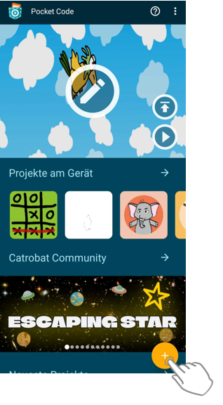
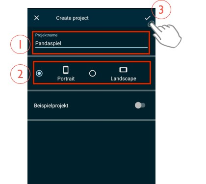
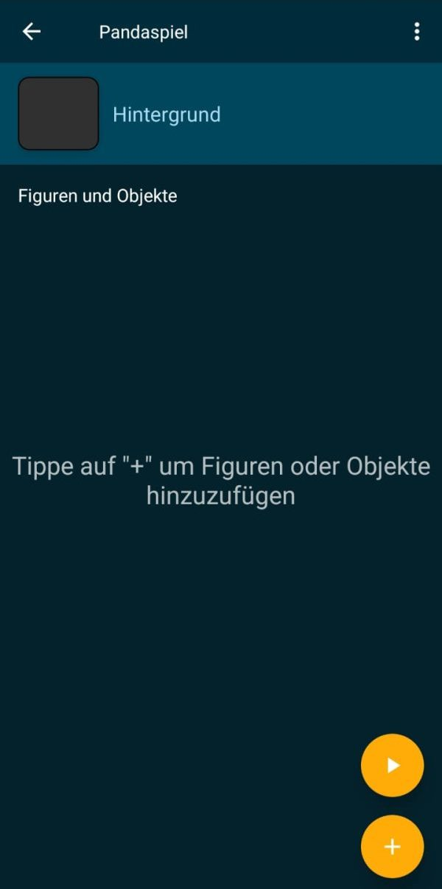

Öffne die App auf deinem Smartphone oder Tablet.

\
Tippe auf das + Symbol, um ein neues Projekt zu erstellen\
[Bild öffnen](../../../media/getting-started/Screenshot-2024-11-25-140205.png)

Gib dem Projekt einen Namen (1) und entscheid, ob du ein Spiel im Hochformat (Portrait) oder im Querformat (Landscape) erstellen willst (2).

\
Bestätige anschließend mit dem Häkchen (3).\
[Bild öffnen](../../../media/getting-started/NeuesProjekt-1.jpg)

Du bist nun in deiner Projekt Ansicht. Ganz oben siehst du den Namen deines Spiels.

Darunter befindet sich der Hintergrund – aktuell ist der Hintergrund leer. Willst du ihn ändern, tippe drauf.

Unter dem Hintergrund siehst du den Bereich für deine Figuren und Objekte, die du deinem Spiel hinzugefügt hast. Aktuell ist der Bereich noch leer.

Rechts unten siehst du zwei wichtige Buttons:

\
Mit dem Play Button startest du dein Spiel.

\
Mit dem Plus Button fügst du eine neue Figur/Objekt deinem Spiel hinzu.

\
Du bist nun in deiner Projekt Ansicht.\
[Bild öffnen](../../../media/getting-started/ProjektAnsicht-e1732693840403.jpg)
