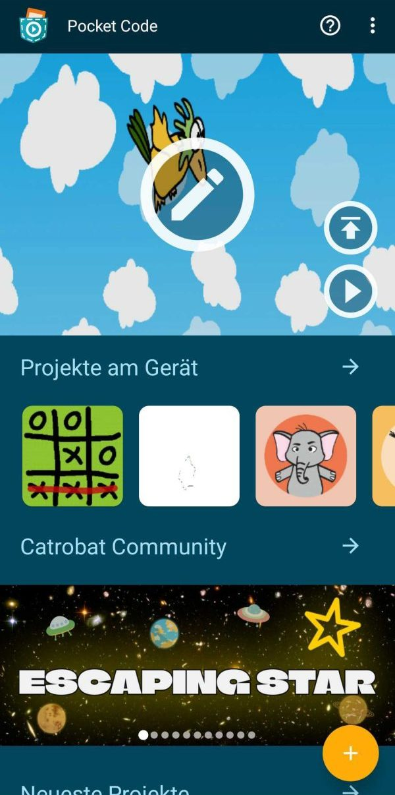

Wenn du Pocket Code startest, siehst du den folgenden Start Screen.

In der oberen rechten Ecke gibt es ein  Symbol, das dich zur Catrobat-Dokumentation führt, die hilfreiche Tipps für dich bereithält.

Daneben befindet sich das Menü  Hier gelangst du auch zu den Einstellungen, wo du die Sprache ändern oder Erweiterungen wie die Plot-Blöcke und mehr aktivieren kannst.

Unterhalb kannst du dein zuletzt bearbeitetes Projekt sehen. Klicke auf das Bearbeitungssymbol , um zum Projektbildschirm zu gelangen, wo du mit der Entwicklung deines Projekts fortfahren kannst.

Nutze den Play-Button , um dein Projekt zu starten.

Mit einem Klick auf “Projekte auf dem Gerät” kannst du auf deine gespeicherten Projekte zugreifen. 

### Wenn du mehr Projekte von anderen Nutzern kennenlernen, sie bearbeiten oder ausprobieren möchtest, klicke einfach auf die Catrobat Community im Share-Bereich. Dort findest du viele großartige Projekte. 

Wenn du ein neues Projekt erstellen möchtest, klicke auf das Plus-Symbol. 
